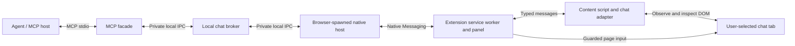

# Browser Chat MCP: Design and Implementation Plan

Status: accepted architecture, partly implemented as a local prototype. Original research: 2026-09-25. Implementation review: 2026-10-09.

Sections 1-16 keep the original research and rationale. Paragraphs marked **Implementation note (2026-10-09)** record where the prototype differs. Section 2 states the decided target experience, section 17 records decisions D1-D13, and **Decision (2026-10-09)** paragraphs mark where they change the original plan. Current status, evidence and the next step are in the dashboard at the top of [HANDOFF.md](HANDOFF.md); setup and tool reference are in [DEVELOPMENT.md](DEVELOPMENT.md).

## 1. Recommendation

Build a **browser-chat integration**, not a general browser automation MCP server:

- A browser extension lets the user explicitly connect the tab and conversation they already have open.
- A local broker manages authorization, conversation bindings, message observations, and outgoing operations.
- An MCP interface exposes a small set of chat operations with structured results.
- A generic, user-configurable DOM adapter covers conventional chat layouts; reviewed site adapters handle applications such as Gemini and WhatsApp Web.
- Use TypeScript throughout. Use the official MCP SDK, WXT for extension development, and Playwright for feasibility experiments and end-to-end testing.
- For chat input, use reviewed page functions with exact-document, draft and operation guards (D6, D11a). Do not expose raw browser commands or arbitrary JavaScript to the agent.

**The important qualification:** generic discovery is achievable; universally reliable sending and complete history extraction from every chat website are not. The product should publish capabilities and refuse unsupported operations rather than guess.

For the first supported AI-chat integration, use Gemini's browser interface. It is a representative target, not an architectural dependency. No model-provider API integration is necessary.

## 2. Scope and Product Contract

### Target experience (decided 2026-10-09)

1. The person installs the extension and starts the MCP server in VS Code.
2. In the browser that has the extension, they open a Gemini chat and click **Connect this chat** in the extension popup once.
3. From then on the agent reads and sends messages in that chat without further intervention.
4. Closing the tab, switching to another chat, or restarting the browser or VS Code ends the connection. Reloading the same chat keeps it.

**Revision (2026-10-12, D13a, D13b):** Multiple agents may connect to the same chat, each with one trusted popup approval for its own autonomous access. The person must see the connected-agent count and a distinguishable entry for each agent, and be able to remove one agent's access without disconnecting the others. Each agent keeps its own grant and request/operation ownership; new or revoked agents cannot join automatically.

For now everything runs in the Podman devcontainer (D12). Approval requires the selected visible chat; an already approved autonomous connection may operate in that exact chat while hidden without activating its tab (D11a). Supervised operations remain visible-only. Current synthetic/installed evidence and limits are in HANDOFF.md. Section 17 records the decisions behind this. The original scope below assumed per-message approval; where it differs, the target experience wins.

### Initial scope

- Desktop Chrome and Edge, one local user, an ordinary HTTP(S) browser tab.
- Existing login sessions remain in the user's browser; login and MFA remain manual.
- One explicitly selected conversation per connection, initially one active writer.
- Read currently rendered messages and retain subsequently observed messages in a bounded, temporary buffer.
- Send plain text, including multiline text and Unicode, through the website's composer.
- Observe incoming messages and revisions to streaming AI responses.
- Give the user a persistent connection indicator, outgoing-message approval, pause, and disconnect controls.

The software may use command-line launchers for installation and MCP startup, but the **chat target is always a browser UI**, not a terminal chat application.

### Not part of the first release

- Native desktop applications, mobile browsers, or arbitrary operating-system window control.
- Automatic login, CAPTCHA handling, account creation, or evasion of platform controls.
- Bulk outreach, contact harvesting, unattended cross-conversation navigation, or built-in bot-to-bot orchestration.
- Attachments, voice messages, reactions, edits, deletes, and automatic link opening.
- Complete server-side history, guaranteed recipient delivery, or guaranteed real-time operation while the browser is suspended.
- A hosted service, distributed database, plugin marketplace, or an LLM embedded in the MCP server.

## 3. Browser Access: Options and Decision

| Approach | Existing logged-in tab | Main benefit | Main drawback | Decision |
| --- | --- | --- | --- | --- |
| Custom WebExtension and local bridge | Yes, after user authorization | Purpose-built selection, observations, approvals, and revocation | Extension and native-host installation; rich editors need additional input support | Recommended product architecture |
| Existing Playwright extension and Playwright MCP | Yes | Already provides a consent and tab-selection workflow | Broad browser permissions and general automation surface; no chat semantics | Use as the feasibility baseline |
| Playwright attached through a remote-debugging endpoint | Only if debugging access was enabled | Mature automation API | Not a universal attach-to-any-running-browser mechanism | Optional developer backend later |
| Playwright-managed persistent browser profile | Requires a separate browser session and login | Predictable, testable environment | Does not deliver the desired existing-tab experience | Useful alternative if extensions are unacceptable |
| Screenshot/OCR and OS mouse control | Visually, yes | Can reach non-DOM interfaces | Focus, layout, scaling, attribution, and duplicate-detection problems | Not a default; no blind visual sending |
| Official messaging/provider APIs | Independent of the browser UI | Usually the strongest delivery contract | Different permissions and scope; does not operate the selected UI conversation | Separate integration, not a replacement for this request |

### Why not simply use Playwright for everything?

Playwright is well suited to controlled browser automation. Its Chrome extension already lets a user choose an existing tab and reuse login state. This is useful prior art and a fast way to demonstrate the basic idea. [1]

However, attaching to a tab does not answer the domain questions: which elements are actual messages, which conversation is authorized, whether a streaming reply is finished, and whether retrying a send will duplicate it. A chat-specific layer remains necessary with any browser-control library.

The proposed custom extension is justified by its chat picker, browser-owned approval UI, continuous DOM observation, and enforcement close to the selected tab. Do not fork Playwright or rely on undocumented extension-transport internals. Start the feasibility work with its documented extension mode; it remains a viable smaller solution if general browser access and best-effort chat handling turn out to be sufficient.

Ordinary CDP attachment is not an alternative to obtaining permission. Playwright documents Chromium-only support and lower fidelity for `connectOverCDP`. Chrome 136 also stopped honoring remote-debugging switches against the default user-data directory. Do not design around silently attaching to an arbitrary daily-use profile or copying its cookies. [2][3]

## 4. User Experience

### First-time setup

1. Install the browser extension and local companion package.
2. Register the companion's native-messaging host for that browser and OS user.
3. Add the MCP server to the agent host. The launcher starts or connects to the local broker.
4. Open and log in to the desired chat website normally.

Installation should ultimately be handled by one companion installer per supported OS. An extension alone cannot install its native host. In the current development setup, both the browser and native host will run inside the same Podman devcontainer. A containerized companion cannot register a host for a separate browser running on Windows or WSL.

### Connect a conversation

1. The agent requests a connection. The broker creates a short-lived pending request without reading any tab.
2. The user brings the desired tab to the foreground and clicks the extension's **Connect This Chat** action.
3. The extension shows the pending client request and detects the active conversation.
4. For a known application, it previews the detected conversation, recent message boundaries, and composer. For an unknown application, the user calibrates these elements.
5. The user approves that connection in the extension's own UI and chooses read-only or send-with-approval mode.
6. The agent receives an opaque connection handle and capability report, not unrestricted browser access.

This is the practical equivalent of the proposed window click: **activate the tab, then invoke the extension**. Merely clicking an operating-system window does not grant DOM access. A screen-sharing picker supplies pixels, not message structure or control rights.

The browser's `activeTab` grant requires a supported user gesture. It can survive same-origin navigation, but it is revoked on cross-origin navigation or tab closure. Application authorization must be narrower than this: selecting another conversation on the same origin must not silently authorize that conversation. [4]

**Decision (2026-10-09, D13 and D1):** The person starts the connection from the popup with **Connect this chat**, and the MCP agent picks it up with a dedicated tool instead of creating a pending request first. One approval grants reading and autonomous sending in that chat, so the target flow has no read-only or send-with-approval choice. The existing agent-first request flow remains for tests.

**Revision (2026-10-12, D13a, D13b):** A chat may have several agent connections, each approved once by the person in the trusted popup. Show their count, distinguishable names/instance IDs, connection status and an individual **Remove access** action; also offer **Disconnect all**. Pending requests and pickup must remain bound to the approved agent, never a shared handle or authorization for a future arrival. Approval covers autonomous read/send until that connection ends, not each message; revocation requires fresh approval to reconnect.

### While connected

- Show the origin, conversation identity, connected client, read/write mode, and connection health in an extension panel.
- Review exact outgoing text and the intended conversation in that panel; approvals never come from page content.
- An injected highlight can help select elements, but it is not an authorization surface because the page can imitate or manipulate it.
- Preserve existing user drafts. Pause writes when unexpected user interaction or a changed conversation is detected.
- Disconnect revokes queued actions, stops observation, and makes buffered content inaccessible through that connection. It does not close the user's tab or log them out.

## 5. Architecture

### Component responsibilities

| Component | Responsibilities |
| --- | --- |
| MCP facade | Tool schemas, result formatting, client compatibility, cancellation, and optional resource notifications |
| Broker | Connection ownership, grants, operation journal, event cursors, deadlines, rate limits, and write serialization |
| Native host | Small transport relay between the browser and broker; no chat parsing or general command execution |
| Extension service worker | Validate browser message senders, enforce selected targets, route observations, execute approved input operations, and handle browser lifecycle events |
| Extension panel | Connection approval, calibration, pending-message review, pause, and revoke controls |
| Content script and adapters | Resolve message/composer elements, identify conversations, normalize messages, and observe UI changes |

Use one installed Node package with separate launcher modes for the facade, broker, and native host. These are small processes with different lifecycles, not separate services requiring a distributed deployment.

**Implementation note (2026-10-09):** The facade, broker and native relay are separate compiled entry points in `packages/companion/dist`. There is no separate content script or side panel: the service worker injects self-contained, reviewed page functions with `scripting.executeScript` into the exact approved document, and the toolbar popup is the trusted panel.

### Why a native bridge?

Native Messaging avoids exposing an unauthenticated browser-control HTTP or WebSocket listener. The host manifest names the exact allowed extension ID. The extension uses `runtime.connectNative` for bidirectional communication. [5]

The native host is **spawned by the browser**, while an MCP stdio server is normally spawned by the MCP client. They cannot both own the same process's standard streams. Native Messaging also uses length-prefixed JSON, whereas MCP stdio uses newline-delimited JSON. A relay and private local IPC explicitly resolve this difference.

On Linux/macOS, use a Unix-domain socket in a user-private runtime directory. On Windows, use a named pipe restricted to that user. Authenticate facade registrations, restrict the native relay role, and use an atomic singleton startup mechanism for the broker. Do not trust a client-supplied display name as authentication.

Version the internal message protocol. Include request IDs, connection generation, deadlines, and validated payload types. Bound and chunk observation batches below the native host's 1 MiB outbound message limit; a 256 KiB application envelope limit is a reasonable starting point. [5]

## 6. Browser Permissions and Input

The current extension requires only `activeTab`, `scripting`, `storage` and `nativeMessaging`. Fixture and Gemini origins are optional host permissions requested through trusted popup actions. Avoid blanket host permissions and browser-history/cookie permissions. Inject scripts only into the selected, approved document.

**Decision (2026-10-19, D6):** Remove both legacy debugger input probes and the required `debugger` permission. Retain the connected page writer; D6 itself does not enable hidden input. The separately approved D11a extends only autonomous operations to hidden tabs without new permissions.

If a future reviewed input driver needs `debugger`, Chrome requires it at install time, not in `optional_permissions`. It is powerful and not technically restricted by `activeTab`; a runtime checkbox cannot add it or constrain its underlying privilege. Such a driver and permission change require a separate decision. [6]

### Sending through modern editors

Do not assume assigning `textarea.value`, setting `innerHTML`, or dispatching a synthetic keyboard event reproduces user editing. Framework-controlled inputs and rich-text editors can reject these changes or keep different internal state. Script-dispatched events are not trusted browser input. [7]

Use small, reviewed page functions limited to the approved document and operation: focus the verified composer, insert text, activate the verified Send control, and inspect the resulting UI state. Preserve original deadlines, exact draft checks, durable intent, browser reservation and one activation. Never paste through the user's clipboard.

The agent cannot choose CDP methods, coordinates, selectors, or executable expressions. The extension resolves and checks targets itself. Do not expose network interception, cookie extraction, arbitrary navigation, or an unrestricted evaluate tool.

Site changes can reject the input or invalidate guards; refuse conservatively rather than adding a fallback or retry. A future debugger driver would not guarantee website acceptance or bypass platform restrictions, and would need explicit attachment/detachment handling. [8]

**Implementation note (2026-10-19):** Connected fill uses one `document.execCommand("insertText")` call, whose browser-generated input events tested as trusted in synthetic pages. Submit uses one script-initiated `click()` on the verified Send control, not trusted user input. Identity, focus, draft and lease checks surround both. The planned three-turn installed Gemini visible-chat acceptance passed on this writer; it is not broad reliability or delivery proof. D6 removes the two legacy popup probes, their fixed payload and debugger permission; native-bridge diagnostics remain. Current evidence and installed-build boundaries are in HANDOFF.md.

## 7. Connections and Authorization

A connection is an application-level binding, not an MCP transport session.

Internally bind:

- Authenticated local client identity and a broker-minted connection ID.
- Browser-profile installation identity and current browser instance.
- Tab ID, frame/document identity, and a monotonically changing connection generation.
- Exact origin and adapter-provided conversation/account identity when observable.
- Granted operations, expiry, approval policy, and any rate/message limits.

Every read and action checks ownership and the current grant. Every write also checks generation, document, conversation, composer, and approval. An opaque handle is not a substitute for authorization.

Use stable conversation identifiers from the visible URL or supported DOM metadata when available. A display title alone is insufficient: different conversations can have identical names, and an AI chat can rename itself. For supported new-chat flows, an adapter may recognize the expected transition from an unsaved chat to its newly assigned conversation ID after submission. Unknown identity transitions require reconnection.

Suggested connection states are `pending`, `calibrating`, `ready_readonly`, `ready_write`, `paused`, `stale`, and `disconnected`. A stale or paused connection never executes queued writes automatically on recovery.

Reloads require a fresh document check; browser or broker restarts invalidate active write grants. Cross-origin navigation, account changes, unexpected conversation changes, or revocation invalidate pending approvals. A tab ID reused later cannot revive an old connection.

**Implementation note (2026-10-09):** Implemented connection states are `pending`, `expired`, `ready_readonly` and `stale`, plus `unknown` for foreign or forgotten requests. Every approval is read-only; write authority comes only from per-operation trusted consents (section 10), so `calibrating`, `ready_write` and `paused` do not exist. Grants last five minutes without renewal (decision D2), `generation` is always 1, and reapproval creates a new connection. A grant binds the owning facade socket, tab, Chrome document ID, origin and conversation ID, plus the exact saved-chat URL including any query for Gemini. Browser-instance identity is approximated by revoking all grants when the extension worker starts fresh.

**Decision (2026-10-09, D2):** Connections have no fixed expiry. They end when the tab closes, the tab shows another chat, the browser or MCP server restarts, or the agent or person disconnects. A reload of the same chat re-attaches to the new document after an observation gap. This needs host permission for the chat's site, requested once during **Connect this chat**, because `activeTab` ends on navigation. A connection with an unresolved send stays readable but pauses sending (D10).

**Revision (2026-10-12, D13a):** Multiple approved owners may bind the same target. An agent disconnect or its facade restart ends only that owner's grant; tab/chat/browser changes end every grant for that target. Individual popup revocation must deny subsequent reads and writes for that owner and invalidate its unstarted work, without revoking other owners or silently allowing the removed agent to reclaim access. Revocation cannot undo an activation that already occurred; retain conservative status for in-flight uncertain operations.

The current broker identifies a facade socket, not an individual model or every chat session inside an MCP host. Add a broker-minted instance ID and a bounded display label for the roster. Host/configuration-reported names are labels, not authenticated model identity; clients sharing a facade cannot be counted as distinct agents without an explicit supported identity boundary. Do not promise automatic identification of separate VS Code chat sessions or models.

Independent readers retain independent cursors. Writers share one composer: serialize the whole fill/proof/submit/evidence sequence, not just each browser input call. Concurrent requests must remain bounded and owner-specific, and must not interleave drafts, consume another owner's authority, or retry uncertain writes. The hourly guard and unresolved-send pause apply to the shared conversation across all agents.

## 8. Generic Adapter Strategy

**No website changes (clarified 2026-10-28):** Every supported integration must operate the existing website through the person's browser login. Never require a site patch, added identity attributes, backend plugin, custom frontend build or redeployment. Reviewed extension page functions may inspect the existing DOM and use approved controls; provider APIs, credential access and React/SDK-state inspection remain outside the boundary. A synthetic fixture with extra markers does not establish compatibility with the stock site.

**Bounded D18-D20 exceptions (2026-10-29):** The person permits bounded React identity/readiness reads, the single reviewed synchronous `getFocused()` identity getter, and own-data `guid` reads from the selected Session and Focus. D20 permits native-adapter source implementation and synthetic wiring only after identity/readiness checks pass. No live access, other SDK calls/state traversal, provider APIs, credentials or website changes are authorized. D1/D2/D16 and all send safeguards remain in force; obtain fresh permission for installed tests.

**Bounded D37 manual exception (2026-11-04):** The person permits one timed, person-operated Company AI Chat diagnostic batch reading only the fixed own-data React identity/selection prop shapes in section 17, at most 12 fibers and one entity-object level per prescribed target. Return fixed type/presence flags, never raw values. This is manual feasibility, not operational identity, arbitrary framework access, agent browser control or connector integration; other exceptions do not transfer. D1/D2 and all consent, privacy and uncertainty safeguards remain unchanged.

**Bounded D38 direct-diagnostic exception (2026-11-04):** The person approves one 60-minute, including-preparation, person-supervised integrated-browser session on one explicitly shared Company AI Chat page, at most 32 diagnostic calls. Section 17 fixes DOM and own-data identity-shape access, including the 64-fiber bound and incomplete type-only summaries. This authorizes only the diagnostic, not general browser control, operational identity, messaging, a new product transport or logged-in regression testing. The person handles navigation/login; all other section 17 exclusions and D1/D2 remain unchanged.

**Bounded D40 profile-context exception (2026-11-05):** The person explicitly approves a fresh 60-minute, including-preparation, read-only diagnostic on one shared Company AI Chat page, capped at 32 calls. Only section 17's fixed visible-profile identity type/presence shapes and bounded own-data dependency chain are added; no hooks, credentials/auth state, global context values, message/draft extraction or operational integration. D38/D39 remain closed; this is not their renewal or proof of shared-page readiness. D1/D2 and all other exclusions remain unchanged.

**Bounded D41/D42 diagnostic adjustment (2026-11-05):** The person approves one fixed-32 dependency probe, then one corrected transmission with a synthetic pre-inspection guard, under D40's original deadline and remaining budget. Keep the same field/target bounds and exclusions. This is not arbitrary context traversal, repeated attempts or operational authority; changing diagnostics does not grant another live call automatically.

**Bounded D43 account-proof exception (2026-11-05):** The person approves up to four same-profile proof calls under D40's original deadline/budget. Only section 17's committed-tree metadata, bounded local profile/ID validation and exact own-data readiness test are added. No credentials, SDK functions, hooks, other root/app state, chat/message/draft access or operational integration; account-side proof does not establish selected-chat continuity.

**Bounded D44 chat-shape exception (2026-11-05):** The person approves up to four same-page selected-chat metadata/type calls under D40's original deadline/budget and section 17's fixed fields. This is not message/draft reading, value/provenance proof, hooks/state access, interactions or operational integration.

**Bounded D45/D46 source-proof exception (2026-11-05):** The person approves bounded composer/timeline source proof and account recheck, then a current-host resolver adjustment, under the original D40 deadline/budget. D46 permits only the selected host's direct own-data alternate candidate and current-root child/sibling graph reconstruction, not alternate-tree traversal. Section 17 fixes all fields and limits; diagnostic success does not authorize operational integration or messaging.

**D53 Company source integration (2026-11-05):** The person requests the actual Company connection system. Reuse the reviewed D47-D51 own-data proof fields and bounds, private captured identity/realm references and shared approval/job policy. An opaque random binding ID names the proven binding; it is not a native account/chat ID or identity evidence by itself. Runtime checks use the existing four-second per-operation budget without adding a fixed connection expiry or reviving a terminal binding. Preserve the fixed-deadline diagnostic checker API. Source/synthetic integration does not authorize live inspection or replace trusted exact-chat popup approval; D1/D2/D5 and all privacy/send guards remain unchanged.

**D61 shared operation policy (2026-11-06):** Keep approval, serialization, deadlines, durable intent, one-offer jobs, uncertainty and settlement provider-neutral. Rendered chat modes declare only necessary editor/schema and supported evidence differences in one descriptor; they do not copy handlers or grant authority. One pure exact-append evaluator consumes normalized direction/text/truncation/coverage captures, retaining conservative ambiguity and bounded-window rules. Stable-ID adapters retain their necessary evidence distinction; do not invent IDs to unify them. Preserve wire compatibility and required site-specific DOM/identity/input checks. Unsupported evidence stays unavailable until its actual capture contract is verified.

Use progressive support, not a universal selector or a model making a fresh guess for every message.

Use one provider-neutral popup control set. A selected-chat adapter supplies eligibility, inspection and supported supervised commands; shared handlers own selection/document checks, rendering and consent phases. Adding a site must not add another provider-named Inspect, Review, Fill or Send button. Keep ordinary review, fill consent and send consent separate because their authority differs. Diagnostic inspection never approves or renews a connection.

| Level | How it works | Supported behavior |
| --- | --- | --- |
| Reviewed site adapter | Versioned adapter for a known UI, initially Gemini | Highest confidence in conversation identity, messages, editor input, and streaming/submission indicators |
| Calibrated generic adapter | User identifies relevant elements; saved declarative profile | Basic reading and sending only where identity and writer checks pass |
| Automatic discovery | Rank semantic DOM candidates and offer a preview | Setup assistance; no automatic write authorization |
| Unsupported | Missing structure, ambiguous identity, or unsupported editor | Explain the limitation and remain read-only or disconnected |

### Unmodified-site identity

- Separate locating UI elements from proving the approved conversation. Native account/chat identifiers are useful when exposed, but a provider's database IDs are not a universal adapter prerequisite. The adapter must supply tested evidence for the lifetime and operations it supports.
- An extension-local token names a binding; it does not prove continuity. Titles, content hashes, CSS selectors, DOM-node identity and quiet periods alone cannot establish that the account/chat is unchanged. Unknown identity refuses both reads and writes, not just sends.
- A document-scoped binding is a possible fallback only after proving same-document continuity, including pending asynchronous navigation and recycled UI nodes. It is not automatically safe because it ends on reload. D16 records the unresolved lifetime choice; D1/D2 remain unchanged until explicitly decided.
- Native message IDs are not universally required either. Observation-local row identities must remain epoch-scoped and must not be presented as provider IDs or fed into stable-ID send evidence. Reuse reviewed snapshot/append evidence only where its assumptions hold; duplicate, missing or ambiguous observations remain uncertain.
- Prefer a small reviewed stock-site adapter using native controls and bounded structural/semantic checks. Calibration can supply declarative locators and previews, never missing identity evidence or authority. Keep approval, deadlines, draft ownership, composer serialization and no-retry policy in the existing shared pipeline.

### Generic calibration

The picker identifies the conversation header/identity region, message-list container, a representative message row, composer, and send control. Optional mappings identify sender, direction, timestamps, and generation status. Preview multiple rows, including both directions when possible, before accepting a profile.

Prefer semantic roles, accessible names, labels, stable attributes, and scoped relative selectors. Avoid absolute XPath and deep positional selectors as primary identifiers. Use `dom-accessibility-api` for accessible-name/role semantics rather than inventing an accessibility parser. Reading DOM/ARIA attributes is not equivalent to having the browser's entire accessibility tree.

Save profiles as bounded declarative configuration: origin, structural signature, selectors, supported editor strategy, and validation rules. Profiles must not contain executable JavaScript. An agent may suggest a repair, but a human must approve a changed target mapping before writes resume.

### Adapter responsibilities

Each adapter implements the same conceptual operations: detect compatibility, identify the conversation, locate the timeline, parse a message row, read the composer, describe input actions, inspect submission evidence, and identify generation state. The broker owns policy, deduplication, cursors, and deadlines; adapters must not reimplement them.

Use bundled, reviewed TypeScript adapters for exceptional application behavior. Sharing the same rich-text editor does not imply two sites share message identity or conversation semantics.

Initially support top-level DOM chat UIs. Open shadow roots can be handled explicitly; cross-origin frames need additional scoped permission and frame tracking. Canvas-only UIs, inaccessible structures, and closed shadow roots without a tested access path are not promised support.

**Current popup implementation (2026-10-28):** One adapter table selects the shared controls and diagnostic callbacks. Legacy fixture/Gemini supervised command names remain internal; Databag has no supervised capability. The marker-free Databag diagnostic returns bounded layout counts and control states, not conversation identity or chat content. Calibration and the stock conversation adapter remain unimplemented; the earlier duplication assessment below is historical.

**Implementation note (2026-10-09):** The prototype has two hard-coded targets, the synthetic fixture and Gemini, with no adapter interface or calibration. Each capability is a separate provider-specific family in every layer: ledger methods, 52 private broker request kinds, client methods, native parsers, worker executors and popup commands. Several fixture-named functions are in fact provider-generic. This contradicts the rule above that adapters must not reimplement policy, and every new site would cost a full copy. Target, starting with the autonomous send path (decision D5):

- One target schema with a `provider` field; the fixture becomes one provider.
- Purpose- or phase-parameterized private commands, for example `list_reviews`/`approve_review` with `review`, `fill` or `send`, and `list_jobs`/`complete_job` with `read`, `fill`, `proof` or `submit`, instead of per-provider command families.
- One ledger pipeline. Adapters supply text constraints, the editor kind and the outcome-evidence rule (section 10).
- An extension adapter registry with `eligibleUrl`, `identify`, `observe`, `capture`, `inspectDraft`, `fill`, `submit` and `completion`, each a self-contained reviewed page function.
- Every safety invariant unchanged: trusted consents, exact targets, one-offer leased jobs, durable intent, browser reservation and status-only recovery.

## 9. Reading and Observing Messages

### Observation pipeline

1. Establish conversation identity and install a `MutationObserver` before taking the initial snapshot.
2. Snapshot only the configured timeline, then reconcile buffered mutations so snapshot-to-stream handoff does not lose updates.
3. Parse changed rows into normalized messages and coalesce rapid revisions.
4. Validate source document/generation and append bounded events to the broker's buffer.
5. Return snapshots or incremental events to authorized callers.

Do not repeatedly extract the whole page. Scope observation to the message area, with separate lightweight guards for conversation identity and composer state. Use occasional reconciliation when needed, especially after reconnects or large rerenders; MutationObserver callbacks alone are not proof of completeness.

### Message model

| Field | Meaning |
| --- | --- |
| `messageId` | Local stable identifier within the connection's observation history |
| `nativeId` | Site identifier, when actually available; otherwise null |
| `identityQuality` | Whether identity is native, locally tracked, or uncertain |
| `sender` | Observed sender metadata, with unknown fields left null |
| `direction` | `incoming`, `outgoing`, or `unknown` |
| `text` | Message text preserving meaningful newlines and code formatting |
| `sourceTimestamp` / `timestampRaw` | Parsed timestamp only when justified, plus original UI representation |
| `observedAt` | When this system observed the message, not when the sender sent it |
| `revision` | Increases when the observed message changes |
| `generationState` | `streaming`, `complete`, `settled_heuristic`, or `unknown` |

Do not deduplicate solely by text hash: two legitimate messages can both say "OK". Prefer native IDs; otherwise track local identity conservatively and report ambiguity. Virtualized interfaces recycle DOM nodes, so node identity alone is also insufficient. A content hash is useful for detecting revisions, not proving identity.

Newly discovered DOM rows are observations, not necessarily newly received messages. Distinguish initial snapshots, live observations, and any later history backfill. A row disappearing from a virtualized list is not a deletion; emit a deletion only when the UI supplies corresponding evidence.

For AI responses, publish revisions under one message identity where possible. Use adapter-specific indicators to declare completion. A quiet period, for example 750 ms without edits, can mean `settled_heuristic`, never confirmed completion. A stalled network can look quiet too.

### Coverage, cursors, and retention

Every snapshot includes coverage such as `rendered_only` or `observed_since_connect`, a freshness timestamp, a generation, and an event cursor anchored to that snapshot. Reading is non-destructive: each consumer maintains its own cursor.

An event cursor encodes an observation-stream epoch and sequence, not a website timestamp or message ID. Buffer eviction, a process restart, or an unrecoverable observation gap produces an explicit `CURSOR_EXPIRED` or gap result and a resynchronization path. Never silently jump to the current end.

Keep transcript data in bounded memory by default. Proposed starting limits are 1,000 events or 5 MiB per connection, whichever comes first; make limits configurable and coalesce streaming revisions. Persist adapter profiles and send-operation metadata separately. Do not present the buffer as a complete transcript archive.

Do not automatically scroll for history in the MVP. Later backfill must be separately authorized, bounded by time/message count, restore the viewport when practical, and identify gaps. The website itself may change presence or read receipts while a conversation is open; the integration cannot promise to suppress those effects.

**Implementation note (2026-10-09):** A read sends a fresh broker challenge that the extension must answer within four seconds; a timeline observer throttled to 200 ms publishes later snapshots. Snapshots are capped at 32 rows, 2,048 UTF-16 units per message and 64 KiB, and each grant buffers 32 events or 256 KiB, far below the starting limits above. Events carry full rendered snapshots, at most two per wait call. Gemini rows always report `identityQuality: uncertain` and `generationState: unknown`. Any capture or parse failure revokes the grant, including more rows, a longer message or a row that momentarily lacks its content element, so ordinary Gemini replies can end a connection. Decisions D3 (completion signal) and D8 (window and failure policy) address this.

## 10. Sending Without Blind Retries

Sending has external effects. A successful DOM click is not sufficient evidence that the message was accepted, delivered, or read.

### Prepare, authorize, commit, reconcile

1. **Prepare:** validate the connection, text limits, idempotency key, and target identity. Create an operation bound to the exact text and connection generation. Do not modify the website yet.
2. **Authorize:** display the exact message and target in trusted extension UI. Human approval is bound to the operation, expires quickly, and cannot be supplied as an agent-controlled `approved: true` argument.
3. **Preflight:** acquire writer coordination for the shared composer across owners; recheck the current document/conversation and ensure the composer has no unrelated draft. Confirm the send control is available and unobstructed.
4. **Fill:** enter text using the verified editor strategy. Read it back and compare against the approved content, allowing only explicitly documented editor normalization. Abort on unexpected user edits or identity changes.
5. **Commit:** durably record that dispatch is starting, recheck the target and approval, then activate the send control once. The browser side rejects duplicate operation dispatches within its current generation.
6. **Reconcile:** inspect newly observed outgoing-message evidence and application status. Correlate native message ID, direction, content, and observation ordering when available. Composer clearing alone is not confirmation.

The steps above describe supervised mode with per-message approval. The product default is the decided autonomous mode below: trusted exact-chat connection approval, no agent-created or widened authority, and all machine-side guards retained.

**Decision (2026-10-09, D1):** Autonomous mode is the product default. The single **Connect this chat** approval allows the agent to send in that chat until the connection ends; the agent cannot create, widen or renew it. A runaway guard allows one message at a time and a generous, configurable hourly cap. Every machine-side guard still applies to each message. Because no person reviews individual messages, chat content can steer what the agent sends into that chat (prompt injection), and the approval text must say so. The supervised three-consent flow remains for tests and as an optional stricter mode.

**Implementation note (T3b, 2026-10-13):** The ledger enforces an operator-only hourly cap (default 60) shared by a conversation's owners and durable across restarts. It counts journal attempts, including evidenced outcomes, before consuming fill consent and again in the intent transaction. Invalid limits fail startup; a backward clock shift cannot drop future-dated attempts from the count. Full-composer serialization and autonomous orchestration remain unimplemented.

### Implemented authority chain (prototype)

The prototype splits **Authorize** into three separate trusted popup consents and keeps every link's authority distinct. The chain is complete for the fixture; the [HANDOFF.md](HANDOFF.md) dashboard tracks which Gemini links are connected. Checkpoint history is in HANDOFF.md.

1. **Prepare** (`chat_prepare_message`): immutable text bound to owner, connection and exact target. SQLite stores only keyed digests. A private status-recovery receipt is returned.
2. **Ordinary review** (**Approve draft (no send)**): short-lived. The public state `approved` means only this review, never send permission.
3. **Fill consent** (**Allow draft fill (no send)**): a separate token, consumed once before any input.
4. **Fill** (`chat_fill_draft`): one leased browser attempt into an empty editor with exact readback. Lost results are `FILL_UNCERTAIN` and are never retried.
5. **Send consent** (**Approve fixture send** / **Approve Gemini send**): offered only after a successful fill, with its own token and expiry.
6. **Fresh baseline and proof**: a challenged rendered snapshot taken after Send consent, then a read-only exact-draft and Send-control inspection, all inside the original request deadline.
7. **Durable intent**: one `BEGIN IMMEDIATE` SQLite transaction refuses another unresolved intent in the same conversation and records `dispatching` before consent and proof are consumed. A persistent private HMAC key binds new attempts across owners/restarts without storing chat identity; legacy unkeyed attempts still block globally.
8. **One-offer job and browser reservation**: the job is offered once and never re-offered. The worker writes and verifies a persistent operation-ID marker before acting.
9. **Guarded activation**: identity, draft, control and lease are rechecked after focus, then one activation. Exceptions after activation begins are uncertain.
10. **Reconcile**: only a unique new outgoing UI row yields `observed_in_ui`; everything else stays `dispatch_uncertain`. Receipts recover status only.

Positive results are UI observations, never acceptance or delivery, and every fill and commit result carries `retryAllowed: false`. In the default autonomous mode, decision D1 replaces the three consents (links 2, 3 and 5) with the single connection approval; the machine-side links stay.

### Gemini outcome evidence (decided, D9)

Fixture evidence relies on stable row IDs. Gemini rows have none, so the staged Gemini job initially has `dispatch_uncertain` status until evidence resolves it. For complete snapshots, require continuous observation since the post-consent baseline (same epoch, no gap), with the baseline rows followed by exactly one new outgoing row whose text equals the prepared text, optionally followed by incoming rows. Window shifts outside D9a, duplicates, retained-row edits or gaps stay uncertain.

**D9a (decided 2026-10-20):** Bounded rolling-window page-sent evidence may use an already omitted baseline. Baseline and every omitted capture must contain the maximum 32 rows, with exactly one exact suffix/prefix alignment retaining at least 30 baseline rows. The dropped-row count cannot decrease. Require exactly one matching new outgoing row, optionally followed by one incoming reply; permit that reply to stream. Keep exact owner/target, same-epoch continuous observations, no truncation, no retained-row edits, no ambiguous overlap and no extra outgoing row. Smaller/byte-trimmed or otherwise ambiguous omitted captures stay uncertain.

Changes solely outside the captured window cannot be detected. D9a is bounded page evidence, never provider acceptance/delivery. Partial-window evidence cannot establish `not_sent`, restore authority, retry or resolve the earlier uncertain live attempt. Capture limits, original budgets, durable intent and one-activation rules remain unchanged. The decision authorizes synthetic implementation only, not a live test.

### Unconfirmed sends (decided, D10)

The original prototype had a global permanent barrier. New keyed attempts pause the conversation shared by every approved owner (D13a); old unkeyed attempts block globally. Person-attributed resolution/status after the old activation lease uses relay-only commands and trusted selected-chat popup **Sent** / **Not sent** choices. Refresh is on demand, pins the exact document and cannot read page message/draft text, approve an agent or change the composer. D58 adds the agent-supplied attempted text from bounded companion memory for identification only, never from a transcript or durable recovery record. Page and person assessments use the same immutable resolution journal; neither restores authority, drops hourly counts or proves provider delivery.

The decided page-reconciliation target follows: after activation, watch for a bounded settle window. The exact new outgoing row (D9) means sent. Exact text still in the composer, Send available and no new row means not sent; a new operation may follow. Otherwise that chat pauses, and the popup offers **Sent** / **Not sent** resolution. Nothing is resent automatically; receipts recover status only, and declared outcomes never prove provider delivery.

D10a (decided 2026-10-13): the system may clear only its own exactly matching leftover unsent draft before a new operation. Fresh exact-target and draft-ownership evidence is required; text equality alone does not prove ownership. Never clear a person's draft. An uncertain prior submit remains paused until resolved; clearing must not retry that operation or restore consumed authority. This policy choice is not authorization for any live development fill or send.

### Result states

| State | What the caller may infer |
| --- | --- |
| `prepared` / `awaiting_approval` | No submission has occurred |
| `approved` | Ordinary no-send review only in supervised mode; not fill or Send consent |
| `dispatching` | Submission may be in progress; do not create a replacement operation |
| `observed_in_ui` | Matching outgoing evidence appeared; this may still be a local optimistic echo |
| `accepted_by_service` | The adapter observed a documented UI indicator of service acceptance |
| `failed_before_dispatch` | This operation did not activate submission |
| `unknown` | A submission might have occurred, but its outcome cannot be established |

Recipient delivery/read status is a separate optional observation, never inferred from `observed_in_ui`. Likewise, an AI reply beginning is useful evidence but does not identify a formal provider-side delivery receipt.

**Implementation note (2026-10-09):** Implemented operation states are `awaiting_approval`, `approved` (ordinary no-send review only), `expired`, `stale`, `unknown`, `dispatch_uncertain` and `observed_in_ui`, plus `draftFill` metadata (`fill_approved`, `filling`, `filled`, `failed`, `uncertain`). `dispatching` exists only inside the journal, known pre-activation refusals are reported as `DISPATCH_UNAVAILABLE` instead of `failed_before_dispatch`, and `accepted_by_service` is not implemented.

### Idempotency and crash behavior

Store operation IDs, client-scoped idempotency keys, target identity, a keyed content digest, phase, and available receipt metadata in SQLite. Persist the transition to `dispatching` before issuing input. Avoid storing message bodies in the durable journal by default.

The same key and arguments return the existing operation; reuse with different arguments is an error. A retry of `commit` returns or reconciles the existing operation and does not click again. Restart recovery treats an interrupted dispatch as `unknown`, and new write grants require user approval. Journal retention and the deduplication window must be explicit; expired operation handles are rejected, not replayed.

**Exactly-once delivery cannot be guaranteed through an arbitrary UI.** A crash can occur after the website accepted the message but before the broker saw evidence. Prefer an uncertain result requiring review over an automatic duplicate. If the website itself retries or duplicates a request, the MCP layer cannot provide stronger server-side guarantees than the website exposes.

Serializing agents does not lock out the human or the website. Fresh guards, draft checks, and cancellation reduce races, but cannot make multiple UI actions an atomic transaction. This is another reason to keep uncertain targets read-only and require supervised sending initially.

## 11. MCP Interface

Keep the public tool list small and stable. Per-connection capabilities are returned as data rather than dynamically exposing arbitrary browser tools.

| Tool | Main arguments | Result and behavior |
| --- | --- | --- |
| `chat_request_connection` | Optional user-facing label | Short-lived connection request; waits for browser-side user selection without scraping tabs |
| `chat_get_connection` | Connection request ID | Pending/ready state, connection handle, generation, target summary, capabilities, and health |
| `chat_read_messages` | Connection handle, bounded limit, optional snapshot-pagination token | Structured snapshot, coverage, freshness, and event cursor; no automatic scrolling |
| `chat_wait_for_events` | Connection handle, event cursor, bounded timeout and limit | Incremental observations/revisions/status changes; returns normally on timeout |
| `chat_send_message` | Autonomous connection handle, text, idempotency key | One broker-owned attempt; sent, not sent or unresolved assessment; exact-key status replay never activates again |
| `chat_prepare_message` | Connection handle, expected generation, text, idempotency key | Operation ID, canonical preview, and approval state |
| `chat_commit_message` | Operation ID | Executes only if approved and still valid; otherwise reports the blocking state |
| `chat_get_operation` | Operation ID, optional status-recovery secret | Current status and evidence; receipt recovery cannot restore approval or permit replay |
| `chat_disconnect` | Connection handle | Revokes access and cancels pending work |

Tool names use lowercase letters, digits, underscores, and hyphens for VS Code host compatibility. This table describes the intended interface, not a claim that every argument/capability is implemented. Use shared Zod schemas, bounded inputs, output schemas, and structured tool results. Include a serialized text representation where needed for older clients. Mark reads appropriately; mark sending as a non-read-only external action. Tool annotations help clients present risk but are not access controls.

**Implementation note:** Legacy supervised prepare, fill and commit remain fixture-only public tools; autonomous fixture/Gemini sending uses `chat_send_message`. The broker owns its one original deadline and all write phases. Exact-key replay reads existing status, and receipt recovery never grants writes. Every send/commit result has `retryAllowed: false`; transport loss after commit begins stays unresolved. Installed/live acceptance is separate from synthetic coverage in the [HANDOFF.md](HANDOFF.md) capability matrix.

The prototype also has `chat_fill_draft` for one separately approved unsent fill and diagnostic `browser_chat_feasibility`. `chat_request_connection` takes no label and `chat_read_messages` has no pagination token. Inputs use strict Zod schemas and results carry `structuredContent`, but no tool declares an output schema. Most legacy refusals are plain `CODE: No chat was accessed.` text; write tools return structured codes. See the [DEVELOPMENT.md](DEVELOPMENT.md) tool reference for exact contracts.

### Target tools (decided direction, 2026-10-09)

The autonomous flow adds provider-neutral tools; exact names may change during implementation:

- A connection pickup tool that waits a bounded time for a chat the person connected from the popup and returns its handle.
- `chat_send_message { connectionId, text, idempotencyKey }`, which runs fill, proof, intent, activation and evidence internally and returns sent, not sent or unresolved (sending paused), never inviting an automatic resend.
- A wait-for-reply tool that returns the newest incoming reply once it is complete or settled (D3), or times out.

`chat_read_messages`, `chat_wait_for_events`, `chat_get_operation` and `chat_disconnect` stay. The supervised prepare, fill and commit tools stay for the fixture and tests.

Domain failures should be actionable, for example `CONVERSATION_CHANGED`, `DRAFT_PRESENT`, `APPROVAL_REQUIRED`, `ADAPTER_STALE`, `BROWSER_DISCONNECTED`, `CURSOR_EXPIRED`, and `SEND_OUTCOME_UNKNOWN`. Return structured error details with whether a safe retry is possible. A transport failure after dispatch does not become a known send failure.

### Receiving does not automatically wake an agent

The universally useful baseline is `read_messages` plus a bounded `wait_for_events` call, for example 20 seconds with a server-configured cap below the host's tool timeout. Waiting must not hold the writer lock or prevent disconnect/cancellation.

An optional resource template such as `chat://connections/{id}/messages` can support change subscriptions. However, a notification to an MCP client is not a guarantee that its host will start a new model turn or send a reply. An always-on responder needs a separate host/orchestration loop and explicit user authorization. The MCP server is a connector, not that scheduler.

The person has designated a Databag direct chat as the AI0 work channel (D21). During an active turn, use cursor-based event waits at work checkpoints and while awaiting needed information. Keep the approved connection open across wait timeouts and normal responses; the earlier one-hour test limit is not a grant lifetime. This is cooperative message handling, not continuous interruption or demonstrated idle-host wake-up. [AGENTS.md](AGENTS.md#databag-work-channel) defines routing, baseline/newness, delegated requests and stop rules.

Before a voluntary final response, D23 requires a checkpoint-specific Databag finish/continue question and a genuinely new explicit answer. A pre-stop notice is not permission. The [finish gate](AGENTS.md#before-intentional-completion) keeps the active turn available through bounded waits while the host permits, without disconnecting the work channel. It is an agent instruction, not a browser consent or MCP-enforced host lifecycle control; it cannot guarantee warning before forced interruption or wake a turn that already ended.

Question routing (2026-10-30): ask directly in Databag, not through agent-controlled questionnaire dialogs. If the channel cannot safely carry the question, report the blocker in plain Copilot text and await an explicit instruction there. Required host/tool and browser consent prompts remain mandatory; uncertain sends are never retried or bypassed to ask another question.

### Current protocol compatibility

As of this research date, the official TypeScript SDK's stable v2 line implements MCP `2026-07-28`. That revision removed protocol-level initialization sessions and changed resource subscriptions to `subscriptions/listen`; older examples using only `resources/subscribe`, a permanent HTTP GET stream, or `Mcp-Session-Id` are not the current protocol shape. [9][10]

Use the official SDK and its documented compatibility facilities for the target hosts, rather than hand-writing either protocol generation. Verify actual VS Code and one other host during the feasibility phase. Keep connection IDs and operation IDs explicit application handles across both generations.

Start with stdio. If resources are added, serve private, immediately stale chat snapshots rather than shared-cacheable transcripts. Treat subscription notifications as hints to read after the last application cursor. Do not depend on transport-level replay for recovery. [10][11]

## 12. Lifecycle and Deployment

### Browser and extension lifecycle

Manifest V3 service workers can terminate and restart. A native-messaging connection keeps the worker alive while connected, but the design must still survive crashes, browser updates, sleep, tab discard, and native-host loss. Keep only recoverable routing state in extension session storage and authoritative operation state in the broker. [12]

On reconnection, establish a fresh document/generation, resnapshot, and report any observation gap. Do not auto-replay pending sends. Background rendering and website updates can be throttled or stopped, so health reports must distinguish connected, observing, stale, and suspended states.

**Implementation note (2026-10-09):** The broker is started by hand (`npm run dev:broker`); the MCP facade only connects and otherwise reports `BROKER_UNAVAILABLE` (decision D4). Each facade process is one owner, so restarting the MCP server or the broker drops that owner's grants and in-memory operations. The worker polls the broker through one persistent native port per provider. If that watch stops after a five-second reply timeout, a parse failure or a disconnect, it restarts only after a new approval or a worker restart, which also marks an observation gap; until then reads and browser jobs time out while the grant still looks ready. Health reporting is limited to snapshot age (`recent` or `old`). Other publications and completions open one short-lived native port each.

**Decision (2026-10-09, D4 and D12):** The MCP server starts the broker itself when none is running, using the existing singleton and recovery checks, and connects at startup so popup-first connections can reach it. The product target stays the devcontainer: container Chromium with the person's Gemini login, plus the native host, broker and MCP server in the same container. Host-browser deployments remain a later option.

### Local, container, and remote hosts

The extension and native companion run where the browser runs. For this project's Podman devcontainer workflow, that means **Chromium, its installed extension, the native messaging host, the broker, and the MCP facade all run inside the same container**. Node/npm and Chromium are installed in the image; WSLg's X11 socket only carries the browser window to Windows. The container browser has its own persistent profile: users log in there manually; the extension cannot attach to existing tabs in Windows or WSL Chromium.

For an eventual non-container desktop deployment, run the native companion alongside the user's chosen desktop browser. Container-based development does not change that product requirement. A broker inside a container cannot access a separate host browser just because both have an address called `localhost`.

Use stdio and private local IPC among processes in the container, with no TCP browser-control listener. The synthetic fixture runs on container port 8787; VS Code may forward it for optional Windows preview, but the devcontainer does not publish a fixed host port. If a future deployment separates the MCP host and browser companion across machines or containers, add an **opt-in authenticated Streamable HTTP facade** through a deliberately configured private tunnel. This is a separate deployment profile, not a reason to expose the browser's debugger port.

The HTTP endpoint must validate Origin and Host, authenticate and authorize every caller, and bind to loopback by default. Use TLS for non-loopback access and the SDK's documented authorization facilities for remote deployments. A tunnel does not replace application authorization; never enable wildcard browser origins or assume CORS alone protects a local control endpoint. [11]

With the agent and browser both inside this devcontainer, remote broker access is unnecessary for the MVP. Defer its packaging and authentication UX unless the target deployment later requires separate locations.

## 13. Security and Privacy

| Risk | Required control |
| --- | --- |
| Agent accesses unrelated conversations | User-selected bindings, authenticated ownership, exact target checks, no arbitrary tab or recipient selection tools |
| Malicious page impersonates approval | Approval only from extension-owned UI; browser-provided sender identity validation; no page-to-native command forwarding |
| Incoming message contains prompt injection | Treat all chat content as untrusted external data, never as system instructions or executable configuration |
| Injection persuades agent to exfiltrate information | Per-message review by default, narrow recipient grants, message limits, and host-side instruction boundaries; sanitization alone is insufficient |
| Misrouted or duplicated send | Fresh conversation/document guards, preserved drafts, one writer, durable operation journal, and explicit unknown outcomes |
| Broad extension capability is abused | No debugger permission in current mode, small reviewed command surface, selected-target enforcement, no raw browser tools, and visible browser/user revocation |
| Local web page probes the companion | Native Messaging and private IPC by default; authenticated, origin-validated HTTP only when explicitly enabled |
| Sensitive conversations persist unexpectedly | Bounded memory buffers, no transcript/screenshot logging by default, restrictive local file permissions, and explicit retention controls |

Render previews as text, not executable HTML. Do not read browser cookies, passwords, unrelated page regions, local storage, or network payloads for convenience. Do not log authorization material. Built-in adapters are reviewed code; configuration profiles cannot download and execute code.

Local operation does not mean chat content stays local after it is returned to an agent: the MCP host may forward it to a cloud model or retain tool logs. Make that boundary explicit during connection approval. The website's encryption protects its own transport, not exported plaintext in an agent context.

The trust boundary excludes a compromised browser, installed companion, extension, or malicious process running with equivalent OS-user access. These controls constrain agent and page behavior; they do not turn a powerful browser extension into a sandbox against its own code.

Respect each site's terms and account rules. Browser automation is not made compliant merely by using the official website. WhatsApp, for example, publishes restrictions on adversarial automation and messaging behavior. Do not promise universal platform approval or evade anti-abuse measures. [13]

## 14. Libraries and Code Organization

| Area | Selection | Reason |
| --- | --- | --- |
| Runtime/language | Node.js 24 LTS and TypeScript | Shared browser/server types and a mature local tooling ecosystem |
| MCP | Official `@modelcontextprotocol/server` v2; documented legacy compatibility when needed | Current protocol support without a homegrown implementation |
| HTTP, if enabled | Official `@modelcontextprotocol/node` integration | Reuse transport/SDK validation instead of designing another protocol |
| Extension build | WXT, Manifest V3, small TypeScript UI | Extension-specific development and packaging; no large UI framework required |
| Validation | Zod v4 | Shared runtime validation for MCP, IPC, adapter profiles, and observations |
| DOM semantics | Native DOM APIs and `dom-accessibility-api` | Incremental observation and standard accessible-name handling |
| Browser input | Reviewed page functions with guarded `insertText` and Send activation (D6) | Exact approved document and operation; no general automation API or debugger permission |
| Operation journal | SQLite through `better-sqlite3` | Local transactional state; no database service |
| Tests | Vitest and `@playwright/test` | Deterministic domain tests and real extension/browser workflows |

Pin tested versions when implementation begins. Check native SQLite packaging on each supported OS. WXT does not replace understanding browser permissions or lifecycle rules. [14]

Keep three main code units initially: shared contracts/domain logic, the local companion/MCP package, and the extension with its bundled adapters. Keep tests adjacent to the behavior they cover and share a deterministic fixture-chat application. Do not create a generalized remote plugin platform or multiple browser backends before the first adapter works.

**Implementation note (2026-10-09):** Actual choices are Node 24 with built-in `node:sqlite` (`DatabaseSync`) instead of `better-sqlite3`; `node:test` and `playwright-core` 1.63 with the container's Chromium instead of Vitest and `@playwright/test`; MCP SDK `@modelcontextprotocol/server` and `client` 2.1.0, Zod 4.6.5, TypeScript 5.9.3 and WXT 0.21.4. `dom-accessibility-api` and `devtools-protocol` are unused. There is no shared contracts package: Zod schemas live in the companion, and the extension re-validates native replies with hand-written checks, so every protocol change must be mirrored by hand.

## 15. Implementation Plan and Gates

The following work starts only after approval of the design.

| Phase | Deliverables | Exit criteria | Rough effort |
| --- | --- | --- | --- |
| 0. Feasibility | Existing Playwright-extension experiment; minimal chat fixtures; targeted rich-editor and permission probes; MCP host compatibility check | Select an existing tab; read bounded messages; demonstrate an authorized send on a disposable Gemini conversation; identify native-driver requirements and any policy blockers | 2-3 engineering days |
| 1. Read-only vertical slice | Local broker, native relay, extension connect/revoke UI, basic adapter, MCP request/read/wait/disconnect tools | No access before approval; only selected conversation returned; snapshot/event handoff and revocation work; no writes implemented | 4-6 days |
| 2. Safe sending | Debugger input driver, explicit install-time permission disclosure, prepare/approve/commit flow, durable journal, draft/conflict checks | Rich-editor round trip works; crash/retry tests do not cause a second dispatch; uncertain outcomes are surfaced correctly | 5-8 days |
| 3. Generic support | Calibration picker, declarative profiles, Gemini-specific streaming/identity behavior, second distinct chat integration | Known site works without calibration; an unfamiliar fixture works through calibration; broken profiles stop writes; no core changes are needed for the second adapter | 4-7 days |
| 4. Packaging and hardening | Installer/uninstaller, reconnect UX, client documentation, privacy controls, targeted cross-browser/manual tests | Clean installation and removal; supported browser/host matrix passes; secrets and transcripts absent from default logs | 4-7 days |
| Later | Extra site adapters, history backfill, richer messages, additional browsers, remote profile, tightly scoped autonomous grants | Each feature gets an explicit capability, permission policy, and acceptance tests | Scope separately |

For one engineer, a supervised useful alpha is approximately 2-3 weeks; a hardened local Chromium release is roughly 4-7 weeks. These are planning ranges, not commitments. Browser-store review, enterprise policy constraints, adapter breakage, remote deployment, and multi-OS installers can add substantial time.

The earliest go/no-go is Phase 0. If the full-control extension's required permission or native installation is unacceptable, choose a separate Playwright-managed profile or a more limited read-only product; do not hide the tradeoff behind an unreliable synthetic-input fallback.

### Status (2026-10-09)

The effort column above is the original planning estimate, not a schedule. D6 (2026-10-19) supersedes the original debugger-driver plan for current visible-chat input; hidden-tab input remains separately scoped.

- **Phase 0:** done except a connector-driven live send. Container GUI, extension, native host, VS Code MCP, fixture input, live Gemini structure and read checks, and a debugger fill probe passed.
- **Phase 1:** done for the fixture and one observed Gemini UI variant: installed-toolbar approval, reads, events and revocation. Read robustness gaps remain (HANDOFF findings R1 and R2).
- **Phase 2:** fixture done, including installed-toolbar fill and send. Gemini consent, fill and proof are connected privately; dispatch, outcome evidence and public routing remain.
- **Phase 3:** not started. There is no adapter interface, calibration, completion semantics or second site.
- **Phase 4:** not started. There is no installer, broker auto-start, production popup or host matrix.

## 16. Verification Strategy

### Deterministic tests

- Parse message text, multiline code, Unicode, timestamps, unknown senders, quoted messages, and repeated identical messages.
- Exercise streaming revisions, delayed continuation after a quiet interval, optimistic outgoing rows, and virtualized node recycling.
- Verify snapshot-to-event cursor consistency, bounded-buffer overflow, cursor expiration, and reconnection gaps.
- Test connection expiry, exact-origin checks, generation mismatches, account/conversation changes, stale approvals, and competing clients.
- Inject failures before filling, before dispatch, immediately after dispatch, and after UI evidence but before the tool response.
- Retry identical operations after each failure; assert no second dispatch from the connector and no false delivery claims.
- Verify that malformed IPC, page-origin approval attempts, oversized payloads, and agent-controlled arbitrary browser commands are rejected.

Use Playwright's bundled Chromium with a persistent context for automated extension tests. Its documentation notes that branded Chrome/Edge removed the command-line flags used for extension side-loading, so separately validate the installed-extension path in real supported browsers. [15]

### Real-site acceptance

Use disposable conversations and authorized test accounts. Start with Gemini, then a distinct messaging-style web UI; WhatsApp Web is a candidate subject to platform constraints and explicit test consent. Do not automate ordinary personal conversations in CI.

Acceptance requires correct message boundaries, successful plain-text submission with honest evidence, handling of route/title changes, safe pause on ambiguous identity, and visible revoke behavior. A site is supported only for the browsers, UI variants, locales, and operations actually validated. Automated fixture success alone does not certify a live site.

### Performance targets

Initially target observation-to-event latency under 500 ms at the 95th percentile for active fixture tabs, excluding network/model generation time. Target cached reads under 200 ms, bounded memory, and no full-page rescans per keystroke. Measure these during implementation; they are not current results. No latency target applies while the browser or website is suspended.

## 17. Decisions

### Confirmed by the prototype

- Chromium first, developed in a rootless Podman devcontainer that holds Chromium, the extension, the native host, the broker and the MCP facade.
- Gemini's web app is the first real AI-chat target; a local synthetic fixture is the deterministic test target.
- Local stdio MCP, private Unix-socket IPC and Native Messaging; no network control listener.
- Trusted extension-owned approval, durable intent, one guarded activation and no automatic retry. The prototype implements the supervised three-consent form; D1 makes one connection approval the product default.
- No transcript persistence: private SQLite stores operation metadata, keyed digests and receipt hashes only.
- Current visible-chat input uses reviewed page functions; the two earlier debugger input probes and required permission are removed by D6 (2026-10-19).

Databag is the selected second chat UI (D14). Installers beyond the devcontainer are not needed for now (D12). None of this ties the architecture to a particular model provider.

### Decisions (2026-10-09)

The review raised D1-D9. The user's target experience (section 2) and answers on 2026-10-09 settle most of them and add D10-D13.

- **D1 Per-message consent: decided.** One **Connect this chat** approval grants autonomous reading and sending in that chat (section 10). Runaway guard: one message at a time and a generous, configurable hourly cap. The supervised three-consent flow stays for tests.
- **D2 Connection lifetime: decided.** No fixed expiry. The connection ends on tab close, chat switch, browser or MCP server restart, or disconnect; reloading the same chat keeps it (section 7).
- **D3 Completion signal: decided.** A quiet-period `settled_heuristic` plus a reviewed Gemini indicator reporting `complete`. The indicator needs a fresh human-authorized read-only DOM review of a disposable chat.
- **D4 Broker start: decided.** The MCP server starts a detached broker on demand and connects at startup; `npm run dev:broker` stays for debugging.
- **D5 Provider-neutral pipeline: decided.** Build the autonomous send path provider-neutral (section 8), reusing today's primitives, and add no new provider-specific command families.
- **D6 Debugger permission: decided (2026-10-19).** The person chose to remove both legacy input probes and the required debugger permission after the planned visible-chat live test passed on the connected page writer. Retain that guarded writer and native-bridge diagnostics. Hidden-tab operation (D11) is not enabled by this change. If a future driver needs debugger input, review its permission and operation-chain integration separately; never revive the probes or expose raw browser commands.
- **D7 Checkpoint size: decided.** One checkpoint per authority boundary when it follows an established pattern, with shorter handoff entries.
- **D8 Observation window and failure policy: decided.** Publish the newest rows with `omittedBefore`, mark per-message truncation explicitly within the frame limit, and when URL, document and conversation are unchanged skip a failed capture instead of revoking; challenged reads then return `OBSERVATION_UNAVAILABLE`. Identity changes still revoke.
- **D9 Gemini outcome evidence: decided.** The append-only rule in section 10.
- **D9a Bounded rolling-window send evidence: decided (2026-10-20).** The person approved the bounded exception in section 10 rather than retaining complete-history-only evidence with pre-dispatch refusal. Synthetic implementation only; no live test is authorized.
- **D10 Unconfirmed sends: decided.** Resolve from page evidence and pause only the affected conversation across all owners when still unclear, with a one-click popup resolution. New keyed attempts use the shared conversation barrier; legacy unkeyed attempts remain globally blocking (section 10, D13a).
- **D10a Leftover draft: decided (2026-10-13).** The user permits clearing only the agent's own exactly matching unsent leftover draft, never a person's draft. Require fresh target/ownership evidence and resolve uncertainty first; no retry or restored authority. See section 10. This policy is not a live-test grant.
- **D11 Hidden tab: decided, phased.** The first phase required a visible chat, including its own window. D11a approves the second autonomous hidden-tab phase; supervised operations remain visible-only. Hiding a tab does not itself create or renew a connection; closure, target change, revocation and the other connection-ending rules remain.
- **D11a Hidden page-writer contract: decided (2026-10-19).** After synthetic feasibility, the person approved synthetic-first implementation. Reuse reviewed page functions only for an already approved exact autonomous chat, without activating its tab or changing the foreground tab. Keep visible trusted-popup admission, owner/document/URL binding, original deadlines, composer serialization, fresh read/proof, durable intent, persistent reservation, one activation and conservative outcomes. Derive the hidden allowance inside the extension from its stored autonomous grant, never agent input. Retain supervised visible-only defaults; refuse human/unknown drafts and do not relax D10a provenance on visibility loss. This decision authorizes no live test, new permission or general browser driver.
- **D12 Target platform: decided.** Keep the devcontainer: container Chromium, native host, broker and MCP server in one container (section 12).
- **D13 Connection start: decided.** The person clicks **Connect this chat** first and the agent picks the chat up (section 4).
- **D13a Agent binding: revised and decided (2026-10-12).** Multiple agents may connect to the same chat. Show how many and which agents have access, with individual removal. Supersedes the earlier exclusive-recipient decision and the several-facade refusal proposal. Grants, requests and operations remain individually owned; writes to the shared composer must be serialized. Section 7 explains the facade identity limit.
- **D13b Additional-agent admission: decided (2026-10-12).** The user chose per-agent approval once. Each agent needs its own trusted popup approval for autonomous read/send in the selected chat, not per-message approval. No automatic admission of later arrivals or silent re-admission after removal. A disconnected, restarted or revoked owner needs fresh approval; same-chat reload preserves the existing owner's connection (D2).
- **D14 Second chat UI: decided (2026-10-28).** The person selected the standard self-hosted Databag web client, deployed from `balzack/databag:latest`. Reuse browser login, the trusted **Connect this chat** approval and the provider-neutral pipeline (D1, D5); do not add Databag API access, credential handling or provider-specific command families. Scope identity to one selected conversation and document, not the whole server. Keep deployment addresses out of tracked configuration, fixtures and documentation. Public-source review and synthetic checks come before a separately authorized installed read or send test; a mutable image tag alone does not establish the running UI version.
- **D15 Website modifications: superseded and resolved (2026-10-28).** Earlier approval to prepare a Databag frontend compatibility patch is historical. The person clarified that the MCP/extension must never require changes to an accessed website. Do not deploy the patch or make site modification a setup prerequisite. The tested patched-contract implementation is not stock Databag support. Retain exact-origin permissions, browser-only access and exact-chat approval; change the connector, not the website. Section 8 states the cross-provider constraint. No live access is authorized by this decision.
- **D16 Stock Databag binding and lifetime: open (2026-10-28).** Prove a native-UI binding against same-URL switches, pending asynchronous selection, account changes, duplicate labels, recycled DOM and readiness races before enabling reads/writes. A source-based isolated experiment shows identical DOM and zero mutations can accompany a changed synthetic channel behind an index-keyed row; a node token/observer alone is insufficient. If safe same-document binding is established but cross-reload identity is unavailable, choose explicitly between a document-scoped connection requiring fresh approval after reload and retaining D2 with Databag unsupported. No shorter lifetime, weaker identity, internal-state access or tab-wide approval is silently adopted.
- **D17 Databag compatibility baseline: decided (2026-10-29).** The person says legacy support is unnecessary while this integration is starting and proposes updating their server before further inspection. Target the current unmodified upstream web client, not a second legacy adapter. Pause legacy implementation/recalibration pending that person-managed upgrade and verification of the actual served UI. An ordinary upstream update is not the superseded integration patch (D15), and this decision authorizes no server/deployment change by the agent. Source build paths do not prove a published tag or running version; do not prescribe an unverified image. D16 and D1/D2 remain unchanged; upgrading alone does not establish safe binding or read/send support.

- **D18 Databag framework identity feasibility: decided, synthetic-only (2026-10-29).** The person explicitly chose the bounded synthetic investigation after the native header/details review. Permit narrowly scoped, read-only React access to selected account/chat identity and readiness in disposable synthetic tests only. No live-site inspection, SDK calls, provider APIs, credential access, site changes or operational integration is authorized. Feasibility is unproven; retain exact-chat approval and all send safeguards. This does not resolve D16 or weaken D1/D2. Section 8 records the limited exception; wider access needs a separate choice.

- **D19 Pure selected-focus getter feasibility: decided, synthetic-only (2026-10-29).** The person explicitly chose **Allow this one getter in synthetic tests** after D18's stale-hook counterexample and public-source review. Permit invoking only the reviewed synchronous `getFocused()` identity getter in disposable synthetic tests; its reviewed SDK 0.0.44 body destructures and returns `cardId`/`channelId`. No other SDK method, SDK-state traversal, credential access, provider API, live inspection or operational integration is included. This tests stale-hook refusal, not safe account/readiness binding or D16. D1/D2 and all send safeguards remain unchanged.

- **D20 Native Databag implementation scope: decided (2026-10-29).** The person explicitly chose **Allow the bounded native-adapter implementation** after D19's account-transition counterexample. Permit only own-data `Session.guid`/`Focus.guid`, the approved synchronous `getFocused()` result and bounded React identity/readiness; reject accessors. Implement/test a stock adapter through the existing pipeline only after its checks pass. No other SDK traversal/calls, credentials, provider APIs, website changes, new browser-control surface or live access is included. Retain D1/D2/D16, fail closed on unknown identity/readiness, and obtain separate permission for any installed test.

- **D21 Databag work-channel usage: decided (2026-10-29).** The person identifies AI0 as the agent and themselves as the counterpart in the designated direct chat, authorizes routine work progress/questions and delegated task requests there, and chooses ongoing use rather than the earlier timed test. After fresh exact-chat popup approval, keep the existing no-expiry connection until it ends under D2 or either party disconnects; do not disconnect at routine checkpoints. No fixed one-hour workflow cap or per-message reapproval applies. Existing per-call deadlines, send caps, owner/identity guards, uncertainty and required host approvals remain. Ended test scopes stay ended; D16's unverified installed lifecycle remains open.

- **D22 Idle-host wake-up: open (2026-10-29).** First use the existing tools during active Copilot turns. Investigate supported host scheduling/continuation before promising unsolicited Databag messages will start another turn. No MCP notification, wait loop or instruction file by itself proves this. Any proposed host integration must preserve approval/owner boundaries, private transcript handling, cancellation and user stop control; new components or authority require an explicit scoped choice. Do not introduce provider APIs, unrestricted browser control or automated renewal as a workaround.

- **D23 Intentional-finish gate: decided (2026-10-29).** The person asks AI0 to request permission through the designated Databag work channel before voluntarily finishing a Copilot turn, then wait for a new explicit finish/continue answer. Silence, wait timeout, old replies and task completion do not authorize finishing. Permission covers only the pending checkpoint; continue means remain active, and stop/pause requests take priority. Follow the canonical [agent rule](AGENTS.md#before-intentional-completion), including uncertain-send, unavailable-channel and forced-host boundaries. Keep the connection open. No new MCP command, consent type, automatic reconnect or guarantee against crashes/timeouts is introduced; D22 remains open.

    **D21/D23 question-routing amendment (2026-10-30): decided.** The person rejects the agent-controlled "Waiting for your response" UI. Ask all agent questions directly through the designated Databag chat; never invoke `vscode_askQuestions` or equivalent questionnaire/choice dialogs. If Databag is unavailable or unsafe for another send, report the blocker in plain Copilot text and await an explicit instruction without opening a dialog or assuming finish permission. Required host/tool approvals and trusted browser consent remain unchanged. This supersedes the earlier questionnaire fallback, not the finish gate, no-retry guards or host lifecycle limits.

- **D24 Compact work-channel observations: decided (2026-10-30).** After the analysis and a confirmed sent choice question, the person explicitly approves implementation. Retain existing names and snapshot defaults; add opt-in `view: "incoming_changes"` to `chat_wait_for_events` for stable-row chats. Return new incoming rows and marked revisions relative to bounded retained observations, advancing over outgoing echoes without their text. Keep history as an explicit `chat_read_messages` action. This is separate from D22 host wake-up and grants no new authority, command family or listener.
    Preserve row/frame order, capture/truncation/omission bounds and explicit resnapshot on expired or ambiguous continuity. Require a retained baseline and ordered overlap; previously captured IDs found in retained history cannot reappear as new commands. Omission-only metadata is not an answer. Do not collapse multiple instructions, promise complete/loss-free history or restart wait budgets after echoes. Gemini explicitly returns `VIEW_UNSUPPORTED` because its uncertain identity cannot inherit this contract. Source implementation, full-gate acceptance and installed loading remain distinct.

- **D25 Databag full-window send evidence: decided (2026-11-02).** The person explicitly approves the narrow confirmation fix in Copilot after the Databag choice request is refused during fill. Permit bounded positive evidence for Databag full 32-row windows, using unique stable-ID/direction/text alignment retaining at least 30 baseline rows, nondecreasing drops and exactly one newly appended outgoing row matching the prepared text, optionally followed by one incoming reply. Refuse gaps, expired baselines, truncation, smaller/byte-trimmed windows, retained-row edits, duplicate/reappearing captured IDs, ambiguous overlap and extra outgoing rows. Keep the existing shared pipeline, limits, deadlines, ownership and one-activation checks; no new provider command family.
    This is bounded page evidence, not provider acceptance/delivery or complete history: changes outside the observed window remain unobservable. Never derive `not_sent` from omitted captures, restore authority, retry or retroactively resolve an existing uncertain send. D9a's approved Gemini rule stays unchanged. Synthetic/full-gate validation and any later installed acceptance remain separate. The approval does not authorize submitting or clearing the unsent choice draft, using a person's profile for autonomous tests or starting a live acceptance test.

- **D26 Databag pending-task facade: decided (2026-11-02).** The person explicitly approves implementation through a new designated Databag message and reiterates Databag-first requests. Add the narrowly scoped official `@modelcontextprotocol/sdk@1.32.2` transport at the existing companion MCP entry point, not a second browser owner or broad dependency downgrade. Its separate diagnostic passed one installed pending continuation (about 11 minutes 42.6 seconds including overhead); SDK 2.3.1 rejected that legacy task-result shape. Do not patch SDK internals, fake result content or bypass protocol validation.
    Retain the facade's one authenticated broker owner and existing tools. Explicit task execution with `view: "incoming_changes"` continues across bounded reads until an event, cancellation or original-connection loss. Ordinary calls retain schemas, snapshot defaults and the 20-second maximum; task-augmented snapshots also remain bounded. Each internal read keeps its deadline/guards; a pending job never extends a consumed read/send request or browser grant. Preserve D24 ordering, outgoing suppression and explicit cursor-gap/resnapshot results. No task-driven reconnect or approval inheritance.
    In-memory task state has a 16-retained-task cap, no time limit while pending, and five-minute terminal-result retention; no private transcript persistence. At most one active incoming waiter per connection spans ordinary and task modes; snapshot reads are independent. Cancellation state is terminal and does not invent an incoming result. Completion/cleanup, cancellation, connection removal, broker loss, cursor expiry, competing waits and ordinary-client compatibility require synthetic/SDK coverage and the exact source gate. Two sequential guarded sends remain distinct from pending tasks; stop on uncertainty. Installed loading requires human coordination and fresh popup approval when the owner restarts. No live send test, D25 change, idle-ended-turn wake-up or restart/shutdown durability is approved here.

- **D27 Sent-question waits and extra-information checks: decided (2026-11-03).** After the November 2 diagnosis, the person requests autonomous offline repair after a computer restart, without active Databag or waiting for another finish answer. Implement the recommended distinct actions through existing owned readers/ledger/tasks; no host integration or new browser authority is included. See [offline checkpoint](HANDOFF.md#offline-send-and-wait-repair-2026-11-03) and [API contract](DEVELOPMENT.md#extra-checks-and-sent-question-waits).
    `chat_check_for_messages` is a dedicated one-read, non-task extra-information action. `chat_wait_for_answer` names an actual confirmed sent `operationId` in the same live owned fixture/Databag connection. Its default retained pre-send cursor catches fast replies before registration; handled continuation cursors cannot precede it or change epochs. Only the latest confirmed send cursor per live connection is retained, without draft text or restart persistence. Failed/prepared/uncertain operations and recovery-only foreign callers cannot supply an anchor.
    Repair zero-timeout parity in both ordinary/task event waits: zero reads once and completes. Keep the legacy event reader, snapshot defaults, existing 16-task cap/five-minute terminal retention, pending cancellation, ownership, continuity, buffer and deadline guards. Dedicated extra checks allocate no task slots and remain independent of pending answer waits. Do not add a provider/private command family or consent type; the existing owned status command supplies opt-in read-only cursor metadata, never write authority.
    Cooperative authorized work and extra checks after a confirmed question can precede registering the eventual pending wait. New incoming rows remain candidates needing interpretation; old replies, echoes, revisions and omission-only metadata are not answer/finish permission. Gaps require resnapshot/clarification, never invented continuity. An uncertain send cannot manufacture an anchor, be retried or regain consumed authority.
    Focused synthetic/SDK checks cover zero parity, task-free checks, actual-send/missing/foreign/failed anchor refusal, pre-send fast replies, ordered extras, revisions, cancellation, gaps and connection loss. The exact 260-unit/141-named-E2E source gate and configured restoration pass; later installed loading/acceptance remains unstarted. Existing installed delayed completion proves suspended continuation only, not concurrent model work or fully ended-turn wake-up; D22 remains open. No transcript persistence, host scheduling component, browser connection request or live test is authorized by this offline repair.

- **D28 Receipt before blocking answer waits: decided (2026-11-03).** After requesting no idle waits and receipt certainty, the person answers the clarification with a genuinely new receipt observation and declines a separate acknowledgment step. They accept a confirmed sent request/empty composer as the practical wait threshold even if reception is delayed. Keep D27's confirmed-sent/outstanding-question workflow; this decision accepts its evidence threshold, not a provider-delivery guarantee or host scheduling change.
    Only pause for an outstanding question actually sent in the owned chat; actual failed/prepared/uncertain status is not confirmed sent. Use non-task checks for extras/idle checkpoints, retain handled cursors and do not continue waiting once the question is answered. Separate recipient acknowledgment is not required. Report composer observations accurately; sent status alone does not expose the current composer or prove delivery. Existing tasks, deadlines, buffers, ownership, consent and no-retry rules remain unchanged.
    An uncertain send still requires its actual outcome to be recorded through the trusted popup; a visible outgoing row or recipient acknowledgment never rewrites that durable status automatically. Recovery receipts inspect status after restart, never restore browser approval, consumed authority or resend permission. Do not wait on an already answered question. No receipt-first runtime/API change or new host component is needed by this decision; source-gate evidence remains unchanged. Changing outcome and installed evidence belong in the [current handoff](HANDOFF.md#current-state-dashboard).

- **D29 Company AI Chat: initial diagnostic scope decided (2026-11-03).** Use generic hostname recognition and the shared, document-bound metadata inspection only, with no deployment identifiers in tracked files. Recognition never grants host/chat authority; no wildcard permission, API/authentication access, framework-state inspection or messaging is added. Native account/chat identity and separately approved installed evidence are prerequisites for further support.

- **D30 Company AI Chat structural calibration: decided (2026-11-03).** The person explicitly approves the text-free structural diagnostic and one manual inspection under a fresh 60-minute including-coordination scope. Extend the existing shared popup with at most 512 visible rows of allowlisted standard tags/roles and generated parent references; retain the 4096-element/depth-64 traversal bounds and omission flags. Unknown tags become `other`, unknown roles become null; never return text, labels, page IDs, classes, URLs, arbitrary attributes or framework/authentication state. No message read, mutation, input, send, host permission or connection is included. Native account/chat identity remains a separate prerequisite under D29. The earlier scope is closed, not renewed; changing timing/evidence belongs in the handoff.

- **D31 Generic manual DOM metadata check: decided (2026-11-03).** The person explicitly approves one person-operated, read-only Elements-panel check of the visible Send control and one existing message bubble, with at most three parent levels each, under a fresh 60-minute including-coordination scope. Return only an allowlisted tag (`button`, `input`, `div`, `p`, `span`, `other`) and presence of `type`, `disabled`, `aria-disabled`, `id`, `data-testid`, `data-message-id`, `data-conversation-id`, `data-chat-id`, `data-role`, `data-author`. No values, text, labels, classes, HTML, screenshots, URLs, Console code, network/storage/framework/authentication inspection, input or send. Timing/result belong in the handoff and active context; a consumed or expired scope never renews itself. Presence alone proves neither stable identity nor messaging safety; no agent browser access or source integration is included.

- **D32 Single-account conversation identity check: decided (2026-11-03).** The person explicitly approves one comparison from the selected chat to one other existing conversation on the same signed-in account, at most one selection under a fresh 60-minute including-coordination scope. Require an already-empty composer; a draft blocks switching, never clear it for the test. Return only path/query/fragment change flags, no URLs/values/names/content/screenshots. No extra account/logout/guest/chat creation/message read request/input/send/DevTools/state/network/credentials/agent browser/source integration. The one response is received, scope completed/closed; private observations/timing remain only in active context. Synthetic account-change failures are not installed cross-account acceptance. URL shape alone never supplies missing account/chat continuity; section 8 guards remain mandatory. D31 is closed, no renewed scope.

- **D33 Text-free identity-attribute discovery: decided (2026-11-03).** The person explicitly approves source implementation and one fresh 60-minute person-operated installed Inspect. Add presence-only `attributeNames` to bounded structure rows: `id`, `data-account-id`, `data-user-id`, `data-conversation-id`, `data-chat-id`, `data-message-id`, `data-testid`, `aria-selected`, `aria-current`. Use `hasAttribute` only; no values/text/classes/URLs/frame/shadow/framework/auth state or mutation. Retain 4096 visits/depth 64, 512 rows, document/visibility and omission guards. Reuse poisoned-getter/clipping/popup/no-authority tests, focused iteration checks and final source gate. Coordination deadline/result stay in active context, never extended by tests/Git. No host permission, account switch/logout, messages/input/send, agent browser, private selectors or binding. Presence finds candidates, not identity proof; D31/D32 closed.

- **D34 Manual DOM identifier-shape check: decided (2026-11-04).** The person explicitly approves one standard-Elements check of the already-selected conversation-list entry and already-visible account control, up to three immediate parents each, under a fresh 60-minute including-coordination scope. Locally examine only `id`/`data-testid`; return tag (`button`, `input`, `div`, `p`, `span`, `other`) and per-attribute category: absent, empty, static/generic, opaque-identifier-like or unsure. Never return values, prefixes, lengths, names, text, classes, URLs, HTML or screenshots. Original deadline stays in active context, old scopes closed. No installation, menu opening, chat/account switching, extra user/logout, Console/network/storage/framework/auth state, input/clear/send, agent browser/value reads or source integration. Unavailable targets stop that part, no substitute inspection. Opaque appearance is only a candidate, not native identity or section 8 continuity proof.

- **D35 Company framework-attachment presence: decided (2026-11-04).** The person explicitly approves one manual standard-DevTools check under a fresh 60-minute including-coordination scope: selected conversation element and already-visible profile/name/avatar region, not a menu. D30-D34 closed; original deadline stays in active context. Only own-property-name enumeration for fixed React fiber/props/container prefixes, at most 64 names processed per target. Absent/unavailable/over-limit stops that part, no substitute/ancestor search. Return fixed presence/refusal flags, no keys/values. No attachment values, component/state/props traversal, getters/SDK calls, DOM content, labels/IDs/text/HTML/screenshots, object dumps, installation/menu/switch/logout/input/clear/send, network/storage/auth inspection, agent browser or integration. Positive flags locate a possible path, not account/chat proof; any value access needs a separate decision.

- **D36 Selected-entry attachment presence: decided (2026-11-04).** The person explicitly approves one manual run of the existing D35 name-only snippet on the already-selected conversation-list element only, under a fresh 60-minute including-coordination scope. Original deadline stays in active context, D30-D35 closed. No profile repeat, other entries, ancestor/substitute search, installation/menu/switch/logout/input/clear/send, values/state/SDK/network/storage/auth/agent browser or integration. Same own-key enumeration, 64-name processing cap and fixed presence/refusal flags; unavailable/absent/over-limit/paste-block stops, no bypass/retry. Return only the fixed JSON string, never keys/values/DOM content/IDs/HTML/screenshots. Presence proves neither current-account identity nor selected-chat/displayed-timeline continuity; any value access needs a separate decision.

- **D37 Batched identity-prop shape feasibility: decided (2026-11-04).** The person explicitly approves one human Console batch on the selected conversation element and already-visible profile/name/avatar region under a fresh 60-minute including-coordination scope. Original deadline stays in active context, D30-D36 closed. Read framework data only through own data descriptors: one React fiber attachment after at most 64 host names, up to 12 fibers through `return`, and each `memoizedProps`; refuse accessors, cycles, ambiguity or overflow. Inspect only fixed identity/selection field shapes, with at most one entity-object level; return fixed presence/type flags, never property names or values. Fixed fields/exclusions follow; no agent browser or operational integration.
    Allow only `accountId`, `userId`, `conversationId`, `chatId`, `id`, `selected`, `isSelected`, `active`, `isActive` and one-level `account`, `user`, `conversation`, `chat` with those fixed ID fields. No hooks/context/store/children/sibling/root traversal, other fields, functions/getters/SDK calls, message/draft/credential/auth/network/storage access, DOM content, object dumps, installation/menu/switch/logout/input/clear/send/agent browser or integration. Unavailable/refused/paste-block stops that target, no bypass/retry/substitutes. Raw framework data stays transient/local, no values returned or persisted. Shape is not committed-root, identity provenance, readiness or continuity proof; further access/operations require a separate decision.

- **D38 Direct browser diagnosis: decided, approved (2026-11-04).** The person explicitly approves replacing manual snippet relay with one 60-minute including-preparation, person-supervised diagnostic session on one explicitly shared Company AI Chat page, at most 32 agent diagnostic calls, no automatic renewal. Integrated-browser tools do not prove reachability of the person's existing Chrome tab. The person opens/shares the page and completes any login themselves; no profile copying, remote-debugging reconfiguration, service restart or credential handling. D30-D37 stay closed. Original clock, remaining budget, page routing and readiness stay only in active context; approval does not prove a site is reachable or ready.
    Browser sharing/snapshots can expose visible page text to the active session; the person must be comfortable sharing that chosen page. Do not deliberately extract message/draft text or save private content, screenshots, traces, URLs, selectors or identifiers in project files, logs or memory. No account/chat switching, menu opening, input, clearing, sending, application/SDK function calls, network/storage/auth inspection, website changes or operational connector integration. Use the existing browser tools only for this diagnostic, never as the product's transport or a logged-in regression-test profile.
    Approved access: light-DOM metadata within the existing 4096-element/depth-64/512-row bounds, plus own-data identity/selection shapes on only the selected conversation-list element and visible profile region. Retain the 64-host-name limit and D37 fixed fields/one entity level; the ancestor-fiber bound is 64 through only `return`/`memoizedProps`, not hooks/context/store/children/sibling/alternate/root-state. Reject accessors, cycles, ambiguity and malformed links. Permit distinct cap-reason flags and clearly incomplete type-only summaries at a depth cap, never raw values/names or successful identity claims. Do not repeat an unchanged refused probe; adapt diagnostics only within these fixed limits. Broader access, side effects or another page require a separate choice. Section 8 records only this diagnostic exception, not operational authority.

- **D39 Clean-page diagnostic handover: decided, approved (2026-11-04).** Following the explicit handover request, the person opens a replacement integrated-browser tab and shares it as the sole diagnostic page. D38's original deadline, remaining call budget, fixed read-only bounds and exclusions remain; no clock reset, concurrent target, profile copying, remote-debugging setup or authentication inspection. Stop if login or a login redirect occurs. Compact structured output is recovered on the replacement page; this does not prove host console capture is disabled. Do not inspect unsolicited snapshots/logs or replay an unchanged refused probe. Changing action/results stay in the handoff, private routing only in active context.

- **D40 Profile identity-source shapes: decided, approved (2026-11-05).** The person explicitly approves the fresh session proposed through Databag: 60 minutes including preparation, at most 32 read-only diagnostic calls on one explicitly shared Company AI Chat page. The original conservative deadline, remaining budget and page routing stay only in active context; D38/D39 remain closed, no automatic extension or renewal. Page sharing/readiness must still be verified. Retain one own-data fiber attachment on the visible profile region after at most 64 host names and 64 ancestors. Per non-root fiber, permit at most eight dependency nodes through own-data `dependencies`/`firstContext`/`memoizedValue`/`next`. No hook state, global context values, arbitrary state traversal, queues, functions, root state or alternate trees. Missing, malformed, accessor, cyclic, ambiguous or over-limit paths refuse; no substitutes/retries or partial result on refusal.
    Inspect only own-data type shapes for `accountId`, `userId`, `id`, `homeAccountId`, `localAccountId`, `username`; permit one entity level through `account`, `activeAccount`, `currentAccount`, `user`, `profile`. For `accounts`, inspect entry zero only when its own-data array length is exactly one, with only those same six fields; otherwise report only a fixed unsupported flag, never other entries. This is an identity-metadata-only exception, not authentication access: never follow tokens, claims, cache, instance, SDK/auth functions, network or storage. Raw values stay transient, output only fixed type/presence/refusal flags, no names/values/dumps/private artifacts. No DOM message/draft reads, navigation, input, sending, account changes or operational integration. Finding a shape proves neither committed-account provenance nor readiness/continuity; any further value/source proof needs a separate choice.

- **D41 Fixed-cap profile diagnostic adjustment: decided, approved (2026-11-05).** A genuinely new Databag reply explicitly approves one adjusted type-only D40 profile probe with fixed 32 dependency nodes per non-root fiber, inside D40's original deadline and remaining diagnostic-call budget. This does not renew the window or authorize another target, repeated unchanged refusals or partial results. Keep the same 64 host-name/64 ancestor bounds, fixed identity fields/one entity level/single-account entry rule, own-data descriptors and all D40 exclusions. No hooks, root state, global context values, auth/SDK functions, tokens, claims, cache, network/storage, message/draft reads, interactions or operational integration. The temporary diagnostic retains eight as its default and permits only explicit eight/32 limits; preparation is not live approval. Any further adjustment or value/source proof requires a separate choice.

- **D42 Corrected diagnostic transmission: decided, approved (2026-11-05).** A genuinely new Databag reply approves one corrected fixed-32 D41 profile call inside D40's original deadline/remaining budget, after a copied absent-field handling defect invalidates the preceding result. No target, field, traversal or authority expansion; retain every D40/D41 exclusion. Run a pure synthetic guard on the actual transmitted helper before profile inspection, requiring absent-field/single-account shapes and accessor refusal without getter invocation. Guard failure performs no profile inspection and does not grant an automatic retry. Reject/discard invalid output; no partial result salvage, raw values, private artifacts or operational identity claim. Any subsequent call or value/source proof needs its own choice.

- **D43 Committed-profile account proof: decided, approved (2026-11-05).** A genuinely new Databag answer approves up to four read-only proof calls on the same visible profile under D40's original deadline/remaining budget. Add own-data committed-tree metadata only: `return`/`child`/`sibling`, 64 per chain and 4,096 total nodes, and root `stateNode.current` pointer equality; no other root state or alternate traversal.
    Retain fixed-32 dependencies and sole-account entry. Compare its own username locally with visible profile text, capped at 256 characters; validate own home/local account ID strings at 512 characters each. Explicit readiness exception: own `inProgress` must be exactly `none`, no other auth state. Output booleans/refusals only; synthetic transmitted-helper guard precedes live profile access. No tokens, claims, cache, SDK functions, hooks, root app state, message/draft access, interactions, private artifacts or operational integration. Refusals do not authorize unchanged replay, broader access or renewal; further proof needs a separate choice.
    Account uniqueness is the exact sole account object across every candidate context, not a choice of one wrapper by name, ID or appearance. All wrappers must be ready; different account objects refuse even if their ID strings match. Refined fixed refusal codes and local synthetic controls do not expand the permitted field/traversal surface.

- **D44 Selected-chat identity shapes: decided, approved (2026-11-05).** A genuinely new Databag answer approves up to four read-only metadata/type-shape calls on the visible selected-conversation row or displayed-chat container, inside D40's original deadline/remaining budget. Retain 64 host names/ancestors, fixed-32 own-data dependencies and 4,096 DOM nodes/512 rows. Only non-root `memoizedProps` and approved dependency shapes, no hooks/root state or alternate traversal.
    Fields: `conversationId`, `chatId`, `id`, `selected`, `isSelected`, `active`, `isActive`; one `conversation`/`chat` entity level containing only the three ID fields.
    Output fixed types/presence/refusal flags, never values, message/draft text, auth/SDK/network/storage access, clicks, switching, input, sends or private artifacts. Hidden/unavailable selected targets do not authorize substitutes or menu activation; the person may clarify from existing observation. Shape is not chat provenance, displayed-timeline continuity, connection/messaging authority or operational integration; further proof needs a separate choice.

- **D45 Committed conversation-source proof: decided, approved (2026-11-05).** A genuinely new Databag answer approves up to four read-only same-page continuity proof calls inside D40's original deadline/remaining budget. Locate only the current composer/displayed timeline with D44's bounded metadata; require the same current committed root and host `stateNode`-to-DOM pointer equality. Only D44's first fixed ID field may be read as a local nonempty trimmed string, capped at 512 characters, from approved props/dependencies. Require all candidate IDs agree and both targets share a committed source, then recheck D43's account proof.
    Retain 64 host names/ancestry/sibling chains, 4,096 tree/DOM nodes, 512 metadata rows and fixed-32 dependencies; synthetic transmitted-helper guards precede live proof. Output booleans/refusals only, no IDs/text/dumps/private artifacts. No hooks, other app/root state, SDK functions, tokens/claims/cache, network/storage, clicks, switching, input, sends or operational integration. Refusal does not grant unchanged replay, target substitution, broader values/state or deadline renewal; further authority needs a separate choice.

- **D46 Current-host source resolver: decided, approved (2026-11-05).** A genuinely new Databag answer approves up to four corrected proof calls inside D40's original deadline/remaining budget after D45's committed-tree refusal. Permit only the attached selected DOM host's one direct own-data `alternate` candidate; require exact host-to-DOM binding and exactly one candidate reachable in the bounded current-root `child`/`sibling` graph. Reconstruct ancestry from that graph rather than treating stale parent links as committed membership. Root-state pointer agreement and final current-pointer recheck remain mandatory.
    Retain the 64-name/ancestry/sibling, 4,096-tree/DOM, 512-metadata-row and fixed-32-dependency bounds. No alternate-tree traversal, hooks, other app/root state or additional identity fields. D45 local conversation-source agreement and D43 sole-account/readiness/profile checks remain; joint proof also requires the profile and conversation targets share the same committed root. Synthetic transmitted-helper guards run first, output only booleans/refusals, no private artifacts or message/draft extraction. All other exclusions remain; no switching, input, sends, operational integration, unchanged replay or renewal. This diagnostic does not establish account changes or lifetime continuity.

- **D47 Unconnected Company identity primitive: decided, approved (2026-11-05).** A genuinely new direct Databag reply explicitly approves the source-only port of the guarded D46 same-root/account/conversation proof into the existing Company observation module, exercised with synthetic targets in existing tests. Retain the same own-data fields, direct-host alternate rule and 64/4,096/32 limits; output only booleans/refusals, no private selectors, IDs or transcripts. Keep connection eligibility disabled and existing layout diagnostics unchanged.
    No popup wiring, bridge installation, new private command family, consent or host permission; no connection, message/draft reads, clicks, sends, network/storage, website/configuration changes or further live call. Focused checks precede the unchanged full source gate and a scoped local checkpoint; no automatic push. The scope message was unresolved at source approval; its actual outcome is tracked separately in the handoff. Do not replay it, treat receipt as durable resolution or infer further authority from D46. Source-only approval does not grant operational or installed acceptance.

- **D48 Unconnected document-guarded Company proof: decided, approved (2026-11-05).** A genuinely new direct Databag reply explicitly says yes and requests continued Company work in response to the proposed source-only slice. Wrap the existing D47 primitive in the same observation module, checking exact URL, visible top-level document and attached supplied targets before and after proof. Reuse existing synthetic tests for detached targets, document/URL changes and expiry. This adds document admission/rechecks, not a persistent identity or lifetime-continuity claim; retain D47's fields, bounds and boolean/refusal output.
    No target discovery, popup invocation, bridge, private command family, permission, consent, operational connection, message/draft reads, input, sending or live call. Connection eligibility and layout diagnostics stay unchanged; no website/configuration change, automatic push or renewal of the expired D40 window. Source approval and the scope send's actual outcome remain separate; changing outcome belongs in the handoff. Focused synthetic checks, the exact full source gate and a scoped local checkpoint precede completion; further integration/live authority needs another choice.

- **D49 Adjacent queued-submit harness diagnosis: decided, approved (2026-11-05).** A genuinely new direct answer approves the observed-sent question about D48's existing fixture `hidden_expired_submit` timeout. Investigate only this adjacent synthetic harness timeout and repair a demonstrated local harness defect, if found. Retain every deadline, assertion, sandbox, ownership, grant and no-retry guard; no production behavior, clock/host/security workaround, live access or unchanged full-gate rerun. A substantive repair needs focused validation and a fresh exact gate before any source checkpoint. The isolated pass and later diagnostic repair do not establish the cancelled run's cause; acceptance/evidence remain in the handoff.

- **D50 Unconnected captured-identity check: decided, approved (2026-11-05).** A genuinely new direct answer approves the confirmed-sent source-only checker proposal, separately from the preceding publication/continue instruction. Compare later fresh document-bound proofs with the initial proven account/conversation, retaining only D47's bounded own-data fields and traversal limits. Keep snapshots private to the module and local/in-memory; a normal module factory returns status and an opaque check function, whose results contain only proof booleans/refusals, never identity values. Reuse existing synthetic same-URL/recycled-target, missing/pending/conflicting/expiry controls. This tests captured-source consistency, not asynchronous navigation, connection lifetime or installed acceptance.
    No target discovery, popup/bridge/runtime wiring, connection, permission, consent, private command family, message/draft access, input, sending, network/storage, configuration/site change, live call, automatic push or renewal. Shared private proof internals avoid a second field reader; a future serialized/injected caller must include the reviewed module, not assume standalone function serialization. Focused checks precede a fresh exact source gate and scoped local checkpoint. D1/D2/D5 and all uncertainty/ownership guards remain unchanged.

- **D51 Unconnected checker lifecycle invalidation: decided, approved (2026-11-05).** A genuinely new direct answer approves the confirmed-sent source-only disposal/lifecycle proposal separately from publication/continue. Extend only the existing captured checker with explicit local disposal and terminal invalidation after observed pagehide or hidden-document events. D50 checks current references but does not observe intervening lifecycle events; matching references after return must not revive an ended checker. Remove owned listeners and release captured/input references on terminal disposal/refusal/expiry; later checks return refusal/expiry without profile reads. Reuse compiled-module VM/native-DOM tests for transitions/cleanup. Keep original fields, traversal limits, deadline and private proof output.
    No target discovery, timers/polling, new identity source, popup/bridge/runtime caller, connection, provider/command/consent/permission, message/draft access, input, sending, network/storage, site/configuration change or live call. This is conservative local lifecycle refusal, not complete asynchronous navigation/account-switch or operational lifetime acceptance. Focused checks precede a fresh exact source gate and scoped local checkpoint, no automatic push or live renewal. The preceding publish-and-continue instruction is not finish permission; D1/D2/D5 and all guards remain unchanged.

- **D52 Fresh live read-only checker validation: proposed, unapproved (2026-11-05).** One freshly person-shared, already-signed-in Company page, 30 minutes including preparation and at most six target/proof/checker calls. Reuse the reviewed D47-D51 module, supplied visible editor/timeline/profile targets, same 64/4,096/32 traversal and own-data identity/readiness fields; keep values local and return only booleans/refusals. Temporary checker listeners must be disposed, no persistence. This directly tests the new source on a real DOM, not installed runtime integration, connection, messaging, delivery or complete lifecycle acceptance.
    No navigation, account/chat switching, message/draft reads, input, sends, application/SDK calls, hooks, credentials/auth state, other framework/root fields, network/storage, configuration/site change, provider/command/consent/permission or private artifacts. Person handles navigation/login/share before access. Require fresh explicit scope approval and exact-page readiness; keep its original deadline/counts only in active context, no renewal/carryover from D40/D46. The scope send is uncertain, no live approval/action or valid answer-wait anchor; resolve actual outcome separately and never replay it. D1/D2/D5 and all guards remain unchanged.

The system's value should be **controlled, inspectable chat operations with explicit limitations**, rather than a claim that every website can be automated identically.

- **D53 Company connection implementation: decided, requested (2026-11-05).** The person clarifies that connection means implementing Company Chat AI's actual connection system, not creating another Databag connection. Company currently exposes Inspect only. Wire the existing trusted popup/native/broker/MCP connection pipeline to reviewed Company identity and supported operations, reusing D47-D51 proof fields/bounds and D1/D2/D5 authority; do not create a copied provider command family or a misleading connected state without a verified adapter.
    Stop Databag reconnection requests/waits. Source implementation is requested; fresh live inspection/test approval, exact-page readiness and trusted Company popup approval remain separate. Explicit Company-origin configuration must not grant browser access automatically; authentication callbacks are not connection targets. No provider APIs, credentials, site patch, security relaxation or assumed live approval. D52 remains unapproved until a genuinely new explicit answer; source checkpoints still require focused checks and the exact full gate.

- **D54 Fresh Company target mapping: decided, approved (2026-11-05).** The person explicitly approves the latest bounded proposal and requests periodic tested commits/pushes during implementation. One freshly person-shared, already-signed-in top-level Company chat, at most six read-only calls over 30 minutes including preparation. Identify visible editor/timeline/profile candidates and validate the D53 binding using D47-D51's exact own-data fields and unchanged 64/4,096/32 bounds. Read only bounded DOM tags/roles/control states/selector compatibility and prescribed account/conversation/readiness metadata; compare bounded visible profile identity locally. Return bounded locator/proof flags, never raw account/chat values. This maps a reviewed runtime adapter, not a new consent or command family.
    The person handles login/navigation/sharing. No message/draft text, page-wide text/HTML, private URLs/authentication values, screenshots, interactions, SDK/application calls, hooks/other framework state, network/storage or configuration/permission changes. Reject authentication callbacks before identity reads. The new approval still requires an exact fresh page attachment, absent at pickup; older page metadata is not substituted. Keep original live budgets/handles only in active context and include checkpoint preparation; no automatic renewal. D52/old expired scopes do not transfer; trusted Company popup approval and operational/Send acceptance remain separate.

- **D55 Fresh informational Company lookup: decided, approved (2026-11-05).** After D54's original window ends, a new Copilot answer explicitly approves one freshly shared signed-in top-level Company page for metadata-only lookup: 30 minutes including preparation and at most six calls. Reuse D54's exact locator/proof fields, exclusions and D47-D51 bounds; do not transfer an earlier deadline, page handle or unused call. The separate VS Code browser is information lookup only, never extension/native/MCP development or acceptance. Actual Company Connect/read integration remains D53 source work and requires its own trusted installed popup approval.
    The tool automatically appends accessibility content without a result-only option. The person explicitly permits continuing despite that output, ignoring its text and using only prescribed metadata, then extends the original window to 60 minutes total including preparation. The six-call cap is unchanged and exhausted; no seventh call or operational access is authorized. The reviewed locator and bounded identity-binding check/disposal complete, not message reading, installed acceptance or lifetime proof. Private output, budgets/handles and observations are not reproduced or persisted; all D1/D2/D5 guards remain unchanged.
    D53 source work now uses the actual bundled reader and shared trusted approval/read pipeline. Its first installed read milestone retained unknown sender/completion. The later D56 source slice adds conservative sender hints, not stable row identity, explicit completion or sending. Company still advertises only read capability; stable-row projection remains unavailable. Reload, identity/lifecycle failure, watcher loss and worker startup gaps end the Company grant rather than rebinding it. Source/synthetic checks and installed acceptance remain distinct.

- **D56 Company sender/control metadata: decided, approved (2026-11-06).** The person requests continued functional Company implementation and explicitly approves a fresh sixty-minute, including-preparation, read-only DOM/control-metadata investigation on the selected shared page, capped at twelve calls. Inspect bounded sender-role and native composer-control semantics; return only fixed flags/enums. No message/draft text, input, clicks, sends, framework/SDK state, network/storage, navigation or configuration changes. Native control labels are control metadata, not transcript access. Automatic appended browser text is explicitly ignored and never persisted or used as adapter evidence. Original budgets/handles stay in active context and never renew automatically.
    Source/synthetic work reuses D53 and the shared read/operation pipeline. Conservative bounded row-root role tokens can label outgoing/incoming rows, with unknown fallback for missing/conflicting hints. Identity stays uncertain, completion unknown; recognized incoming rows can use only the existing fresh-observation quiet-period heuristic, not native completion or stable-row evidence. Read-only grants/consent and closed writers remain unchanged at this checkpoint. Further writer integration must preserve trusted exact-chat authorization, draft ownership, durable intent, one-offer reservation, one activation and uncertainty/no-retry guards; this diagnostic grants no live fill/send authority. No provider/command/consent family or private selectors are added.

- **D57 Company guarded writer integration: requested implementation (2026-11-06).** The person's continued D53 functional implementation request is carried through the existing provider-neutral autonomous pipeline. Fresh trusted popup consent explicitly covers read/send; an existing Company read-only grant cannot be upgraded in place. No provider/command/consent family is added. Reuse shared composer serialization, immutable text, original deadlines, fresh read/proof, durable intent, one-offer jobs, persistent submit reservation, one activation and status-only replay.
    MAIN retains the captured private identity proof and exposes only a synchronous bounded editor/opaque-binding identity check. The isolated writer alone owns native input, draft ownership and Send activation. Require exact visible document, native textarea, bounded separate composer, unambiguous Send, empty draft before fill, exact prepared readback and unobstructed enabled Send before submit. Occupied drafts/leftovers are never cleared or replaced; uncertain fill/submit is never retried. Legacy supervised/stable-row operations remain unavailable.
    No automatic Company page-sent/not-sent inference is introduced: uncertain rendered identity and unknown completion do not establish that evidence. Submission remains unresolved until existing trusted person outcome review; this conservative limitation blocks unattended repeated sends. Synthetic native/MCP integration and loss/no-replay checks are not installed writer acceptance. Installed loading, fresh trusted write approval and separately bounded exact-text live-send authorization remain necessary; D56 metadata access grants none of them.

- **D58 Unconfirmed-send message identification: decided, requested (2026-11-06).** The person requests attempted message text in **Refresh status**, since the chat's timestamps are difficult to identify. Show the bounded immutable operation text ahead of timestamp/ID in the existing trusted exact-chat popup, rendered as literal wrapped text, not HTML. No page transcript/draft lookup or new provider, command, consent, send, approval or resolution authority.
    Keep at most 100 read-only previews of at most 4,000 UTF-8 bytes each in companion memory after successful durable intent. They may outlive the draft's write lease but never supply authority. Known outcome, facade disconnect, broker restart or oldest-entry eviction removes the preview; unavailable text is explicit. Never persist plaintext in SQLite/recovery/browser storage, logs, repository or memory notes. Retain the existing eight-entry list cap, four-second eligibility delay, exact document/chat checks, strict payload validation and immutable person-only outcome choices. This source request authorizes no further live send or old-attempt replay.

- **D59 Company durable correlation across recreated bindings: decided, approved (2026-11-06).** The person explicitly approves privacy-preserving durable correlation and trusted older-intent recovery before further testing. The original random-ID/HMAC gap is confirmed synthetically, not proof of the earlier live outcome. Source/synthetic repair is authorized; no new live read/send, shared-page inspection, approval renewal or replay follows.
    Separate fresh document/approval proof from `company_ai_v2_` correlation: SHA-256 over a versioned JSON tuple of canonical origin and the already-reviewed home-account, local-account and conversation IDs. Username is excluded. Only the pseudonymous digest leaves the private proof; raw values are not exported or persisted. Recheck captured proof after hashing and retain terminal lifecycle/deadline checks. Stable correlation never restores access or another owner's authority; old random-ID targets refuse.
    New durable intents carry nullable journal metadata `correlation_version = 1`, identifying the current correlation contract for all providers. Existing missing-version or unkeyed rows remain explicitly unlinked: never rekey, infer their chat/provider, discard or automatically resolve them. They conservatively block all chats while unresolved and count globally inside the unchanged hourly window even after resolution. Known current foreign-chat intents remain isolated.
    The existing trusted popup lists older eligible rows as **Unlinked older attempt**, with unavailable message text, after the unchanged four-second delay/eight-entry cap. A person who can identify an attempt may record its immutable **Sent**/**Not sent** assessment through the existing relay-only status path. This does not attribute the attempt to the selected chat, modify its key, restore ownership/approval, retry or clear a draft. Unidentifiable attempts stay quarantined. Focused restart/reload/account/chat-isolation checks and the exact source gate precede publication; coordinated installed loading and separately bounded acceptance remain required.

- **D60 Empty unconfirmed-review diagnostics: decided, approved (2026-11-06).** After reported D59 loading, fresh owned v2 pickup and one requested read, the person reports trusted **Unconfirmed Sends** shows **Nothing to resolve**, then explicitly approves the proposed limited diagnostic. The older live outcome stays unknown. An empty eligible list alone cannot distinguish an unresolved guard from no applicable unresolved record, and cannot prove a missing older intent resolved. The installed journal's actual cause is not independently established.
    The existing trusted exact-chat review response requires boolean `blockedByUnresolvedDispatch`, computed from the same applicable unresolved predicate used before composer acquisition. With no eligible row, distinguish **Sending paused: no reviewable attempt** from **No applicable unresolved attempts**. A false flag describes only this uncertainty guard, not general send readiness, historical outcome or delivery. Missing/nonboolean or contradictory clear-with-rows replies refuse. No private identity, journal key/path/fingerprint, recovery material or foreign current-chat record is exposed; no message/draft lookup or direct live database/private-broker query substitutes for supported diagnostics.
    Approval covers source/synthetic diagnostics only. Keep D1/D2/D5/D10/D59, current document/owner proof, legacy quarantine, four-second eligibility, eight-entry cap, deadlines, rate limits and immutable status-only outcome choices unchanged. Add no provider, command or consent family; status cannot restore authority, infer an old outcome, clear a draft or replay. Source checks/full gate precede source publication; installed loading and a bounded diagnostic check require later coordination, with no live read/send or restart implied.

- **D61 generic operation core: source direction requested; Company evidence pending (2026-11-06).** After comparing Gemini/Company, the person explicitly requests generic seamless chat modes with minimal site-specific approaches. Implement shared matching/settlement policy and one small mode descriptor, not duplicated provider handlers or a broad registry/transport rewrite. The focused source slice reuses Gemini's exact-append rule and existing pipeline while retaining necessary editor/schema differences. This requests generic source/synthetic implementation, not a new live scope or permission to declare unsupported Company coverage complete.
    Require fresh exact owner/account/chat/document proof, durable one-shot dispatch intent and a challenged pre-submit baseline plus later bounded captures with explicit coverage/continuity. Confirm only one unambiguous newly appended outgoing message matching the immutable attempted text and operation boundary. Old identical rows, changed roles/identity, revisions, gaps, truncation, unsupported omissions or ambiguous alignment remain unresolved. Native row IDs are not invented; Company currently always reports `omittedBefore: true`, so removing its early return cannot safely reuse Gemini's complete-window evidence rule unchanged. Review actual stock-UI outgoing capture/coverage before enabling a rule; current successful latest-row reads establish incoming response, not that contract.
    On sufficient positive evidence, record the existing immutable page-sourced sent resolution, allowing the next operation through the unchanged uncertainty guard. This confirms observation in the UI, not provider acceptance/delivery. Reply readiness and writable composer are separate conditions; retain native input, exact draft ownership, visible eligible controls, shared serialization, original per-call deadlines/rates and one activation. Do not add automatic not-sent inference or resend after missing evidence, restore consumed authority, clear a person's draft or retroactively resolve older/legacy attempts. Trusted person review remains only for genuinely ambiguous outcomes.
    Verify focused synthetic positive and repeated-turn paths plus old/duplicate rows, partial windows/rollover, delayed rendering, human draft/retyping, identity/owner change, lost-result/crash and no-replay controls using existing tests/helpers. Run the exact source gate before publication; then separately authorize bounded installed calibration and a multi-turn acceptance test without per-message popup actions. Source implementation/evidence approval and fresh live approval remain distinct; no provider API, credential/state export, website patch, broader framework access, grant renewal or security/clock change follows from the seamless-chat goal.
    Current source keeps Company's descriptor at unavailable automatic evidence and delegates supported Gemini captures to the shared pure evaluator. Private evidence routing is neutral; legacy exports/tool/wire names remain compatibility contracts. Read/send permissions stay independently controlled by the trusted grant, not the descriptor. Generic refactoring does not itself establish Company outgoing-window continuity, explicit reply completion or unattended multi-turn acceptance; resolve those evidence gaps next with separately bounded installed calibration.

- **D62 Restarted Company read-only calibration: approved, first window expired (2026-11-09).** The person resumes after a computer restart. Source checkpoints are intact; at initial pickup the no-browser diagnostic passes, owned connections are empty and normal MCP startup restores broker/facade processes. The person later designates Databag as the work channel and explicitly approves this bounded calibration there. Keep the existing private profile/journal/configuration, original safety guards and D61's unavailable Company evidence policy.
    Request one freshly person-selected, signed-in Company chat in the existing container Chromium profile, fresh trusted **Connect this chat** for this MCP owner, and a separate fifteen-minute calibration window including preparation. Cap at two public `chat_read_messages` calls, each at most the newest 32 rendered rows. Only existing approved-target identity checks and bounded rendered plaintext/direction/truncation/omission capture are used; keep all private output/handles in active context, never repository/log/memory. Check outgoing capture and retained-window behavior; two read-only snapshots do not prove new-send confirmation or reply completion.
    No send/fill/submit, draft inspection/clearing, new message, outcome choice/older-attempt inference, shared/integrated-browser DOM inspection, broader framework/SDK access, network/storage/profile lookup, screenshot, site patch, privilege/clock/security change or automatic approval renewal. The person handles browser startup/login/exact-chat selection and trusted consent. Start the original budget only on an explicit new calibration answer; do not reset/extend it across coordination or transfer older allowances. Later append/streaming/multi-turn acceptance needs separately agreed scope.
    The first approved including-preparation window expires during coordination with zero Company reads/sends. Latest owned public metadata then confirms separate ready Company and Databag grants; Company pickup is not calibration evidence or renewal of the expired allowance. A new explicit bounded window is required before Company reads. See the [current checkpoint](HANDOFF.md#databag-resumed-company-pickup-ready-calibration-expired-2026-11-09).

## Sources

Primary documentation reviewed for this proposal; facts about a live site's compatibility still require the planned experiments.

[1]: https://github.com/microsoft/playwright/tree/main/packages/extension
[2]: https://playwright.dev/docs/api/class-browsertype#browser-type-connect-over-cdp
[3]: https://developer.chrome.com/blog/remote-debugging-port
[4]: https://developer.chrome.com/docs/extensions/develop/concepts/activeTab
[5]: https://developer.chrome.com/docs/extensions/develop/concepts/native-messaging
[6]: https://developer.chrome.com/docs/extensions/reference/api/permissions
[7]: https://developer.mozilla.org/en-US/docs/Web/API/Event/isTrusted
[8]: https://developer.chrome.com/docs/extensions/reference/api/debugger
[9]: https://github.com/modelcontextprotocol/typescript-sdk
[10]: https://modelcontextprotocol.io/specification/2026-07-28/changelog
[11]: https://modelcontextprotocol.io/specification/2026-07-28/basic/transports/streamable-http
[12]: https://developer.chrome.com/docs/extensions/develop/concepts/service-workers/lifecycle
[13]: https://www.whatsapp.com/legal/messaging-guidelines
[14]: https://wxt.dev/guide/introduction.html
[15]: https://playwright.dev/docs/chrome-extensions

- [Playwright existing-browser extension][1]
- [Playwright CDP attachment][2] and [Chrome debugging-profile restrictions][3]
- [User-activated tab access][4], [Native Messaging][5], and [optional-permission limitations][6]
- [Synthetic-event trust][7], [debugger API][8], and [extension service-worker lifecycle][12]
- [Official MCP TypeScript SDK][9], [2026 protocol changes][10], and [Streamable HTTP][11]
- [WhatsApp messaging guidelines][13], [WXT][14], and [Playwright extension testing][15]